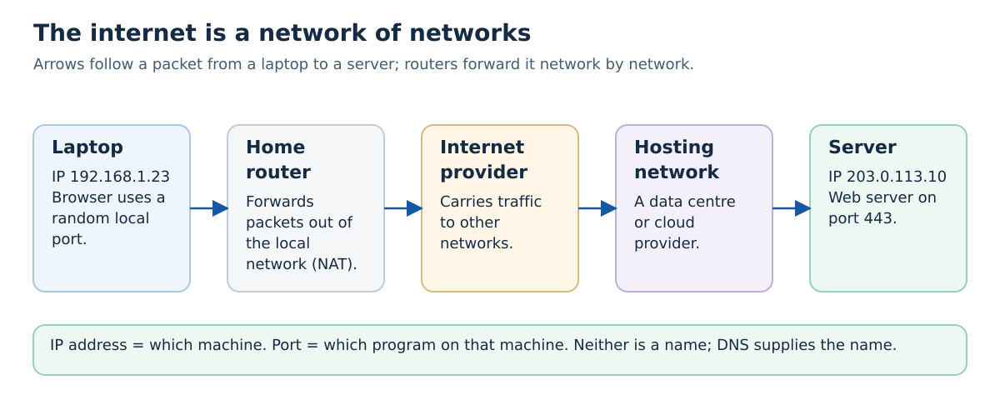
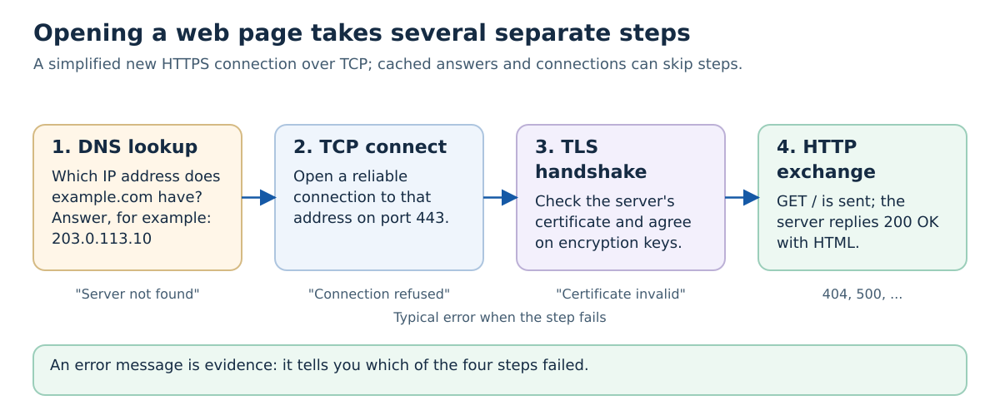
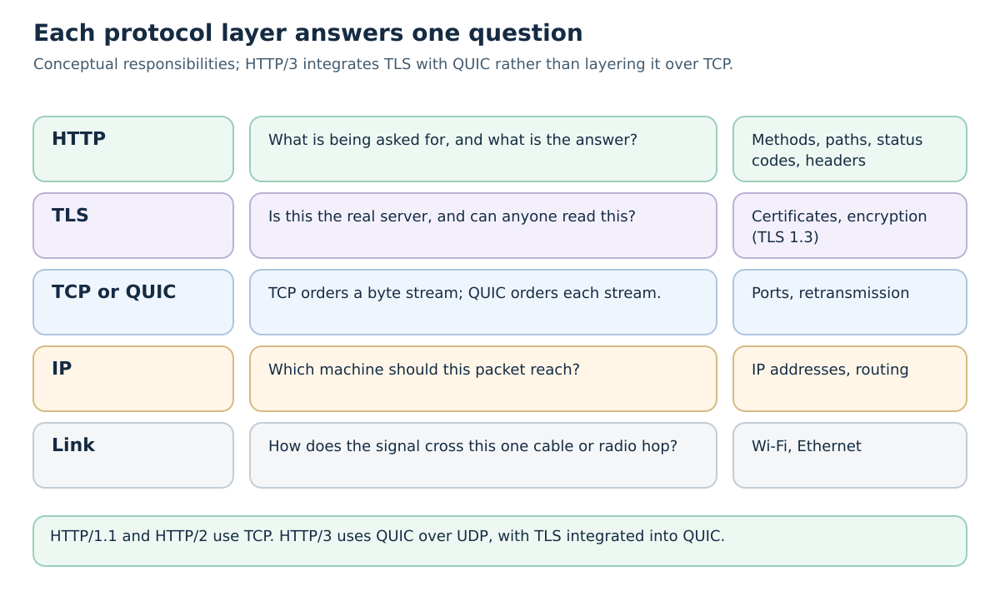
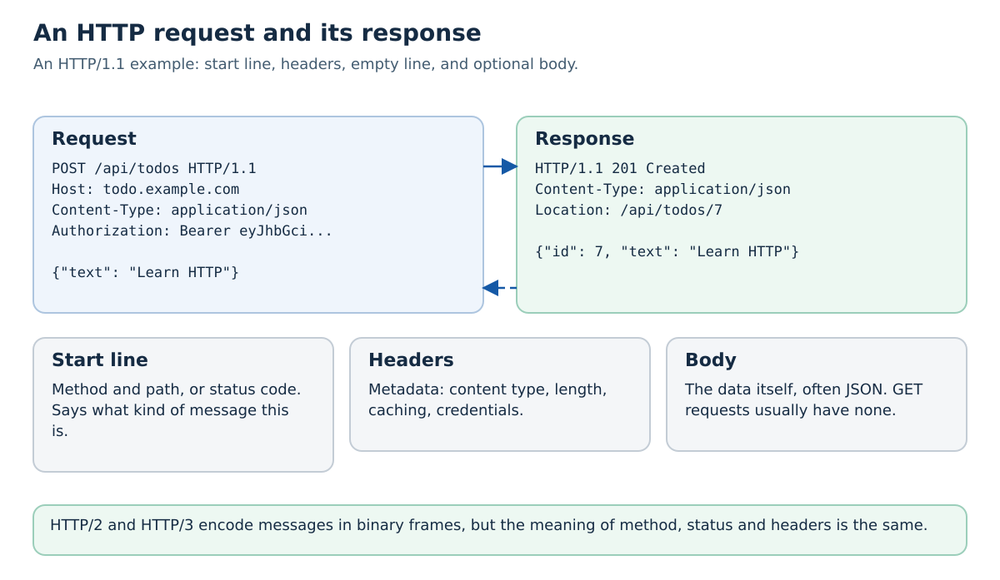
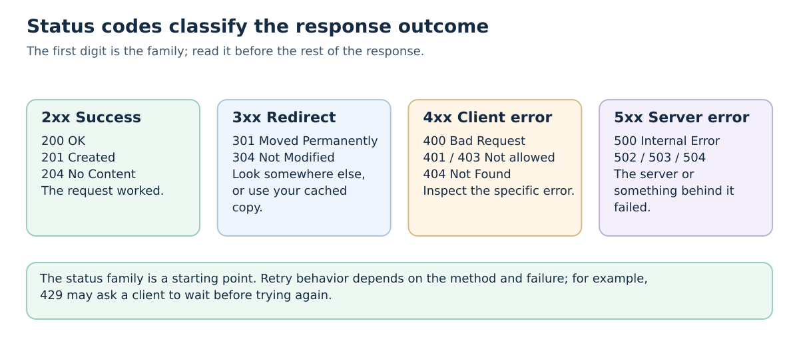
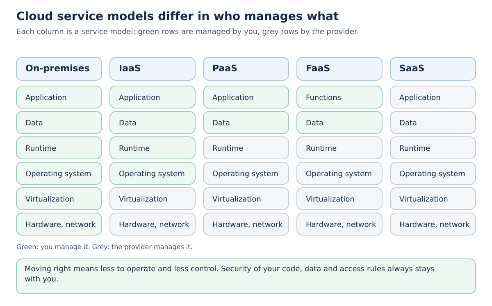
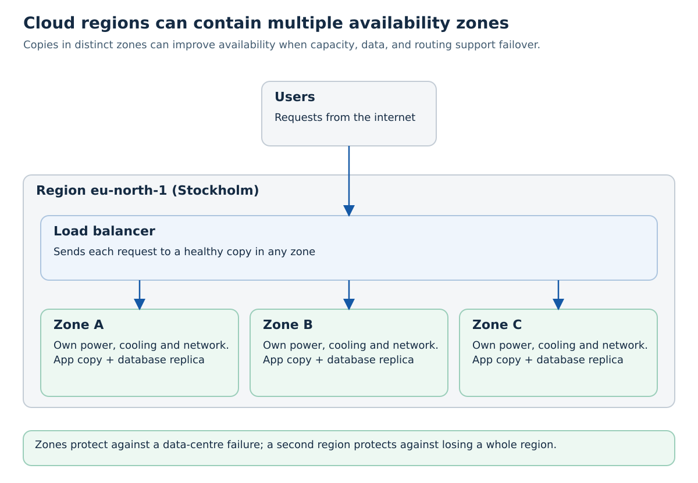
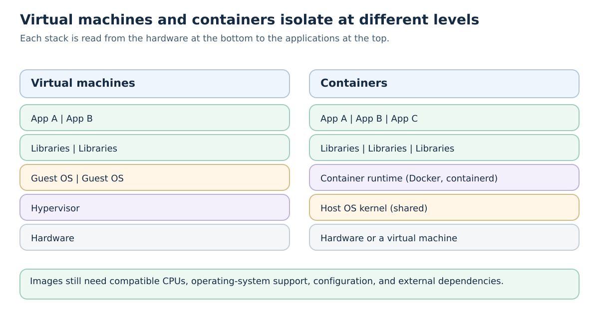
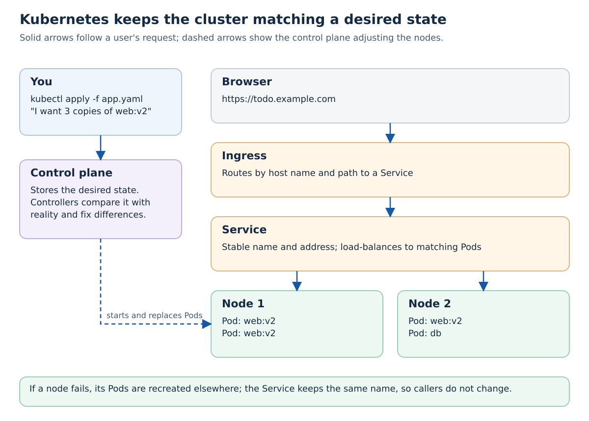

# Tutorial 0: Introduction — The Internet, HTTP, Cloud Computing, and Kubernetes

This tutorial is the map for the rest of the course. It explains, at a basic level, what happens when you open a web page, how HTTP messages are built, what "the cloud" actually is, and why we run applications on Kubernetes. Later tutorials go into each topic in depth; here the goal is to know which part of the system each later tutorial is about.

You do not need to install anything except a web browser and `curl`. Many systems include it; install it with your operating system's package manager if it is missing. In Windows PowerShell, use `curl.exe` to avoid an older alias with different flags.

## Learning Objectives

By completing this tutorial, you will be able to:
- Describe what happens between typing a URL and seeing a page: DNS, TCP, TLS, and HTTP
- Explain the difference between an IP address, a port, and a domain name
- Read an HTTP request and response: method, path, headers, body, and status code
- Explain why HTTP is stateless and how cookies and tokens work around that
- Describe the cloud service models (IaaS, PaaS, FaaS, SaaS) and what you remain responsible for
- Explain regions, availability zones, elasticity, and pay-per-use
- Compare virtual machines and containers
- Explain in one sentence what Kubernetes does, and name its main objects
- Place each tutorial in this course on that map

---

## Why Start Here?

A web application is not one program. A single page load involves your browser, your operating system, a DNS resolver, several routers, possibly a load balancer, a web server, an application, and a database. When something goes wrong, the error you see comes from one of these parts. Knowing the parts, and the order in which they are used, is what lets you read an error as evidence instead of guessing.

The course builds the system up layer by layer: an HTTP API ([Tutorial 1](../01-basic-webapp/README.md)), packaged in containers ([Tutorial 2](../02-docker/README.md)), split into services ([Tutorial 5](../05-microservices-and-k8s/README.md)), and deployed to a Kubernetes cluster in the cloud ([Tutorials 6–7](../06-k8s-getting-started/README.md)). This tutorial gives you the vocabulary for all of them.

---

## Part 1: What Happens When You Open a Web Page?

### Clients and Servers

A **client** is a program that asks for something; a **server** is a program that waits for requests and answers them. Your browser is a client. The program that sends back the page is a server. The same machine can run both: in Tutorial 1, your laptop runs the browser (client) and the Flask application (server).

"Server" names a role, not a kind of computer. A server is usually a process running on a machine in a data centre, but it can also run on your laptop or a Raspberry Pi.

### The Internet Is a Network of Networks



The internet is not one big network owned by someone. It is thousands of independent networks — home and campus networks, internet service providers, university networks such as SUNET, and the networks of cloud providers — that agree to forward each other's traffic. **Routers** connect them. Each router looks at the destination address of a packet and passes it one step closer.

Three identifiers matter:

| Identifier | Example | Answers the question |
| --- | --- | --- |
| **Domain name** | `todo.example.com` | What do humans call this service? |
| **IP address** | `203.0.113.10` (IPv4), `2001:db8::10` (IPv6) | Which machine should the packets go to? |
| **Port** | `443` | Which program on that machine should receive them? |

Well-known ports include 80 (HTTP), 443 (HTTPS), 22 (SSH), and 5432 (PostgreSQL). When you run a development server on `localhost:8000`, `localhost` means "this machine" and `8000` is the port the program listens on.

Your laptop's address on a home network, such as `192.168.1.23`, is a **private** address. The home router translates it to the router's public address when packets leave (this is called NAT). That is why a server on your laptop is not reachable from the internet by default.

### Four Steps Before You See a Page



For a new HTTPS connection over TCP, the following simplified sequence is useful. Cached DNS answers and existing connections can skip work, and HTTP/3 uses QUIC instead of TCP:

1. **DNS lookup.** The Domain Name System translates `example.com` into an IP address. Your computer asks a DNS resolver (usually provided by your network), which asks other DNS servers if it does not already know the answer. The answer is cached for a while.
2. **TCP connection.** The browser opens a connection to that IP address on port 443. TCP makes sure that bytes arrive complete and in order, resending anything that was lost.
3. **TLS handshake.** Because the URL starts with `https`, the browser and server establish **TLS** (Transport Layer Security). The browser checks the certificate chain, hostname, validity, and the server's proof that it controls the associated key. The handshake establishes encryption keys. This protects message content against reading and undetected modification between the TLS endpoints; it does not prove the site's business is trustworthy. See the [TLS 1.3 specification](https://www.rfc-editor.org/rfc/rfc8446).
4. **HTTP exchange.** The browser sends an HTTP request such as `GET /`, and the server answers with a status code and the HTML. The HTML refers to stylesheets, scripts, and images, so the browser sends more requests — often dozens for one page.

Each step has its own typical error. "Server not found" or `Could not resolve host` is a DNS problem. "Connection refused" means the machine was reached but nothing listens on that port. A certificate warning is a TLS problem. A `404` or `500` is an HTTP response from a server or intermediary; inspect the response to identify which component produced it.

### Protocol Layers



The steps above correspond to **layers**. Each layer solves one problem and relies on the layer below for the rest. HTTP does not care whether packets travel over Wi-Fi or fibre; IP does not care whether the bytes are a web page or a video call.

**HTTP versions:** HTTP/1.1 (1997, still widely used) sends readable text messages over TCP. HTTP/2 (2015) sends the same messages as binary frames and lets many requests share one connection. HTTP/3 (2022) runs over QUIC, a newer transport built on UDP that combines the transport and TLS handshakes and copes better with lost packets on mobile networks. The meaning of methods, status codes, and headers is the same in all three versions, which is why this course talks about "HTTP" without a version.

---

## Part 2: HTTP — Requests and Responses

### Anatomy of a Message



For the basic exchanges here, a client sends a **request** and receives a final **response**. HTTP can also send informational responses, and a connection can fail before a final response arrives. HTTP/2 and HTTP/3 use frames rather than the textual start lines drawn below.

A request contains:
- a **method** — what kind of operation is asked for
- a **path** (and optional query string, such as `?done=true`) — which resource it concerns
- **headers** — metadata such as `Host`, `Content-Type`, `Accept`, and `Authorization`
- an optional **body** — the data, for example JSON when creating something

A response contains:
- a **status code** — whether and how the request succeeded
- **headers** — such as `Content-Type`, `Cache-Control`, and `Set-Cookie`
- an optional **body** — the HTML page, the JSON data, or an image

The most common methods:

| Method | Meaning | Typical use | Has a body? |
| --- | --- | --- | --- |
| `GET` | Read a resource | Load a page, list todos | No |
| `POST` | Create something or start an operation | Create a todo, log in | Yes |
| `PUT` | Replace a resource | Update a whole todo | Yes |
| `PATCH` | Change part of a resource | Mark a todo as done | Yes |
| `DELETE` | Remove a resource | Delete a todo | Usually no |

`GET` must not change data: browsers, caches, and crawlers assume they can repeat it safely.

### Status Codes



The first digit groups the response outcome. Retry behavior also depends on the method and the particular failure:

- **2xx** — success. `200 OK`, `201 Created`, `204 No Content`.
- **3xx** — look elsewhere. `301`/`302` redirect to another URL; `304 Not Modified` tells the browser to use its cached copy.
- **4xx** — the request is wrong or not allowed. `400 Bad Request` (malformed input), `401 Unauthorized` (missing or invalid credentials), `403 Forbidden` (the server refuses the operation), `404 Not Found`, `429 Too Many Requests`.
- **5xx** — the server failed. `500 Internal Server Error` (a bug or unhandled error), `502 Bad Gateway` and `504 Gateway Timeout` (a proxy could not get an answer from the server behind it), `503 Service Unavailable` (overloaded or starting up).

A `502` is a useful clue in this course: it usually means the ingress or load balancer works but the application behind it is not running or not ready.

### HTTP Is Stateless

The server treats every request on its own. It does not remember that the previous request came from you. Applications add state on top:

- **Cookies.** The server sends `Set-Cookie: session=abc123`; the browser automatically sends `Cookie: session=abc123` with every later request to that site. The server looks up the session.
- **Tokens.** The client sends `Authorization: Bearer <token>` with each request. A JSON Web Token (JWT) carries signed claims, such as the user ID and roles, so the server can verify it without a session lookup. [Tutorial 12](../12-keycloak/README.md) uses this with Keycloak.

Statelessness is what makes it easy to run many copies of a server behind a load balancer: any copy can handle any request, as long as shared state lives in a database or cache rather than in one server's memory.

### REST and JSON

Most APIs in this course follow the **REST** style: URLs name resources (`/api/todos`, `/api/todos/7`), HTTP methods say what to do with them, and the data is **JSON**:

```json
{"id": 7, "text": "Learn HTTP", "done": false}
```

REST is a convention, not a standard that a server either passes or fails. [Tutorial 1](../01-basic-webapp/README.md) builds a REST API and compares it with JSON-RPC.

### Try It: Read Real HTTP Messages

Use the course method from the [main README](../README.md#how-to-work-through-a-tutorial): predict, run and observe, explain, change one thing.

**Step 1 — curl.** Predict what status code you will get and whether the body will be HTML or JSON. Then run:

```bash
curl -v https://example.com
```

`-v` (verbose) prints the steps. Lines starting with `*` are curl's own notes: look for the resolved IP address, the TLS handshake, and the certificate subject. Lines starting with `>` are the request you sent; lines starting with `<` are the response headers. The HTML body follows.

Explain each part: which line shows DNS worked? Which shows TLS? Which HTTP version did curl use?

**Step 2 — change one thing.** Predict the result of each command before running it:

```bash
curl -v https://example.com/does-not-exist      # a path that does not exist
curl -v http://example.com                      # plain HTTP: no TLS step
curl -v https://no-such-host.invalid            # a name DNS cannot resolve
curl -v https://localhost:9                     # a port where nothing listens
curl -sI https://github.com                     # -I: only the response headers
```

Which step of the four failed in each case, and how does the error message show it?

**Step 3 — the browser.** Open any website, press F12 (or Cmd+Option+I on macOS), and select the **Network** tab. Reload the page.

- How many requests did one page need? Sort by **Type**: which are documents, scripts, stylesheets, images, or `fetch` calls to an API?
- Click one request. Find its method, status code, request headers, and response headers.
- Find a response with status `304` or one served from cache. Why did the browser not download it again?
- Reload with the cache disabled (the **Disable cache** checkbox). How did the total time change?

Keep notes; you will use the Network tab constantly from Tutorial 1 onwards.

---

## Part 3: Cloud Computing

### What "the Cloud" Means

Public cloud computing provides shared computing resources on demand through provider APIs; private clouds can use an organization's own data centres. Instead of buying a server, installing it in a room, and waiting weeks, you call an API or click in a web console and get a virtual machine, a database, or a storage bucket in seconds. You pay for what you use and give it back when you are done.

Large public cloud providers include Amazon Web Services (AWS), Microsoft Azure, and Google Cloud; there are many regional providers as well. Universities and companies also run **private clouds** with the same model on their own hardware. The course cluster is one such environment.

The [NIST definition](https://csrc.nist.gov/pubs/sp/800/145/final) identifies five characteristics: self-service provisioning, network access, pooled resources, rapid elasticity, and measured usage. In practice:

- **Self-service and network access:** clients can request resources through supported network interfaces.
- **Pooling and elasticity:** capacity comes from shared provider infrastructure and can grow or shrink as configured. This is not a promise of unlimited instantaneous capacity.
- **Measured usage:** the platform measures consumption. Billing can include usage charges, subscriptions, reservations, and minimum capacity.

Managed services can reduce the components your team operates, but they are offerings built on this model rather than a required fourth cloud characteristic.

### Service Models: Who Manages What



| Model | You get | You manage | Examples |
| --- | --- | --- | --- |
| **IaaS** — Infrastructure as a Service | Virtual machines, networks, disks | Operating system, runtime, application, data | AWS EC2, Azure Virtual Machines, Google Compute Engine |
| **PaaS** — Platform as a Service | A place to run your code | Application and data | Heroku, Google App Engine, Azure App Service |
| **FaaS** — Functions as a Service | Functions run on each event or request | Function code and data | AWS Lambda, Azure Functions, Google Cloud Run functions |
| **SaaS** — Software as a Service | A finished application | Your users, settings, and data | Gmail, GitHub, Microsoft 365 |

Moving towards SaaS means less to operate and less control. "Serverless" does not mean there are no servers; it means you do not see or manage them.

**Shared responsibility.** Whatever the model, the provider secures what it runs and you secure what you put on it. A cloud database is patched by the provider, but if you give it a weak password or open it to the whole internet, that is your problem. Access rules, secrets, and data protection always stay with you.

### Regions and Availability Zones



A **region** is a geographic location, such as Stockholm or Frankfurt. Many cloud regions offer several **availability zones**: distinct infrastructure locations designed to limit correlated failures. A zone can include more than one data centre, and availability and isolation guarantees differ between providers.

Choose a region for latency, service availability, cost, and the organization's data-location requirements. You spread copies of your application across zones for availability. Note that spreading the stateless application is easy; keeping the *data* safe across zones requires database replication, which [Tutorial 3](../03-databases/README.md) discusses.

### Virtual Machines and Containers



A **virtual machine (VM)** emulates a whole computer. A *hypervisor* lets one physical machine run many VMs, each with its own operating system. Each VM has its own kernel and operating-system state. Startup time, memory use, and isolation depend on the image, hypervisor, and configuration.

A **container** packages an application with its libraries and runs it as an isolated process that shares the host's operating system kernel. Sharing a kernel can reduce per-instance overhead, but startup and memory use still depend on the application, runtime, image download, and host capacity. A container **image** is the packaged, versioned application; a compatible image can run on your laptop, in CI, and in the cluster. CPU architecture, kernel support, configuration, and external dependencies still matter. [Tutorial 2](../02-docker/README.md) builds images with Docker.

The two are combined in practice: cloud providers rent you VMs, and you run containers inside them.

---

## Part 4: Kubernetes in One Picture

### Why Containers Need Orchestration

Running one container is easy: `docker run`. Running a real application is harder. You need several copies of each service for load and for failures, spread over several machines. When a machine dies, its containers must be started elsewhere. When you release a new version, you want to replace copies gradually without downtime. Other services need a stable way to find each copy, even though containers come and go with new IP addresses.

Doing this by hand, or with scripts, does not scale. A **container orchestrator** does it automatically. **Kubernetes** (often written *k8s*) is the most widely used one. Google released it as open source in 2014; it is a Cloud Native Computing Foundation project maintained by its community. See the [Kubernetes overview](https://kubernetes.io/docs/concepts/overview/).

### Desired State



You do not tell Kubernetes *what to do* ("start a container on machine 3"). You tell it *what you want* ("there should be three copies of `web:v2`"), written as YAML and submitted with `kubectl apply`. The **control plane** stores that **desired state**. **Controllers** continuously compare it with the actual state and act on any difference: if a copy crashes, they start a new one; if you change `v2` to `v3`, they replace the copies one by one.

The main objects, at a glance:

| Object | What it is |
| --- | --- |
| **Cluster** | A set of machines managed together by one control plane |
| **Node** | One machine (usually a VM) that runs workloads |
| **Pod** | The smallest unit Kubernetes runs: one or more containers that share a network address |
| **Deployment** | Desired state for a stateless application: which image, how many copies, how to update |
| **Service** | A stable name and address that load-balances to the matching Pods |
| **Ingress** | Rules that route external HTTP(S) traffic by host name and path to Services |

Follow a request in the picture: the browser reaches the **Ingress**, which routes `todo.example.com` to the right **Service**, which forwards it to one of the **Pods**, wherever they currently run.

This is all you need for now. [Tutorial 5](../05-microservices-and-k8s/README.md) explains these objects and the controller pattern, [Tutorial 5B](../05b-k3s-setup/README.md) takes you from SSH access to your group's VM through K3s installation and HTTPS, and [Tutorial 6](../06-k8s-getting-started/README.md) adds optional laptop access. [Tutorial 7](../07-k8s-helloworld/README.md) then deploys an application using Helm.

**A caution:** Kubernetes solves operational problems, and it adds its own complexity. A small project can be served well by a single VM or a PaaS. The course uses Kubernetes because it makes scheduling, discovery, rollout, and recovery visible, and because it is widely used in industry.

---

## Part 5: How the Course Fits Together

Each later tutorial zooms in on part of the picture above:

| Concept from this tutorial | Where the course goes deeper |
| --- | --- |
| HTTP requests, REST, JSON, browser and server | [01 — Basic Web Application](../01-basic-webapp/README.md) |
| Container images, VMs vs containers | [02 — Docker and Docker Compose](../02-docker/README.md) |
| Where data lives, replication | [03 — Databases](../03-databases/README.md), [08 — PostgreSQL](../08-postgresql/README.md), [13 — MongoDB](../13-mongodb/README.md) |
| What runs in the browser and what on the server | [04 — Frameworks](../04-frameworks/README.md), [09 — React with Claude Code](../09-claude-code-frontend/README.md) |
| How to split and connect a system | [04b — Software Architectures](../04b-architectures/README.md), [05 — Microservices and Kubernetes](../05-microservices-and-k8s/README.md) |
| VM access, SSH, K3s, kubeconfig permissions, certificates | [05B — K3s on Your VM and HTTPS](../05b-k3s-setup/README.md) |
| Cluster, nodes, Pods, Services, Ingress, TLS | [06 — Laptop Access](../06-k8s-getting-started/README.md), [07 — Hello World](../07-k8s-helloworld/README.md) |
| Releasing safely and repeatably | [10 — Testing and CI](../10-testing-ci/README.md), [11 — Argo CD and GitOps](../11-argocd-gitops/README.md) |
| Statelessness, cookies, tokens | [12 — Keycloak](../12-keycloak/README.md) |
| Communication between services | [14 — Service Communication](../advanced/14-service-communication/README.md), [16 — Service Meshes](../advanced/16-service-meshes/README.md) |
| Observing a running system | [15 — Monitoring](../advanced/15-monitoring/README.md) |

## Check Your Understanding

1. You type a URL and get "Could not resolve host". Which of the four steps failed? What would you check?
2. Your API returns `502 Bad Gateway` through the cluster's ingress, but `200` when you call the Pod directly. Which component is most likely misconfigured?
3. Why can a load balancer send consecutive requests from the same user to different server copies? What must be true of the server for that to work?
4. Your organization requires data to stay in a particular geographic area. Which cloud choice from Part 3 does that affect, and which provider guarantees would you investigate?
5. A Pod crashes at 3 a.m. Describe what Kubernetes does, using the words *desired state* and *controller*.

## Next Steps

Continue with [Tutorial 1: Basic Web Application](../01-basic-webapp/README.md), where you build the server side of the HTTP exchange you just observed.

## Further Reading

- [MDN: How the web works](https://developer.mozilla.org/en-US/docs/Learn_web_development/Getting_started/Web_standards/How_the_web_works)
- [MDN: An overview of HTTP](https://developer.mozilla.org/en-US/docs/Web/HTTP/Guides/Overview)
- [MDN: HTTP response status codes](https://developer.mozilla.org/en-US/docs/Web/HTTP/Reference/Status)
- [Cloudflare Learning Center: What is DNS?](https://www.cloudflare.com/learning/dns/what-is-dns/)
- [NIST SP 800-145: The NIST Definition of Cloud Computing](https://csrc.nist.gov/pubs/sp/800/145/final)
- [Kubernetes: Overview](https://kubernetes.io/docs/concepts/overview/)
- [High Performance Browser Networking](https://hpbn.co/) — free online book on TCP, TLS, and HTTP
