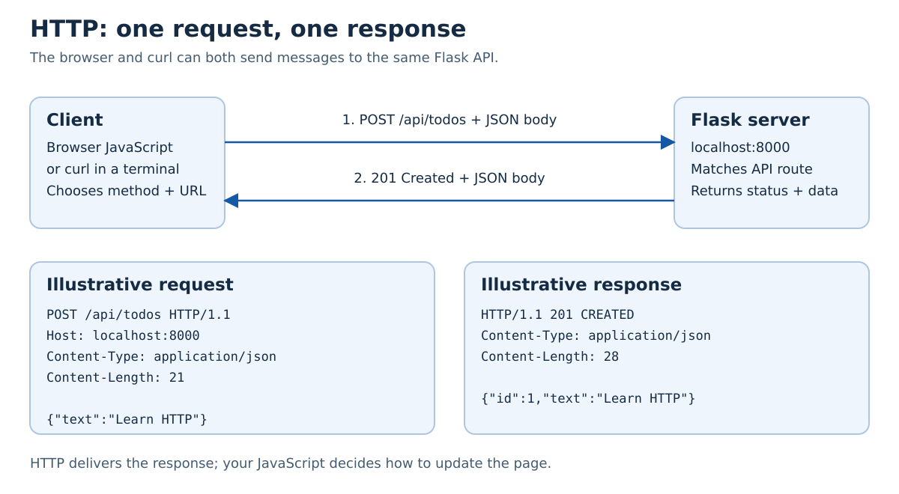
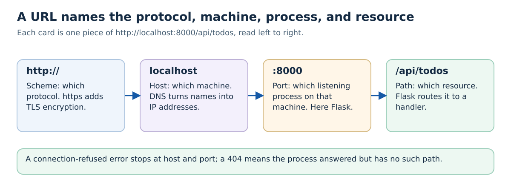
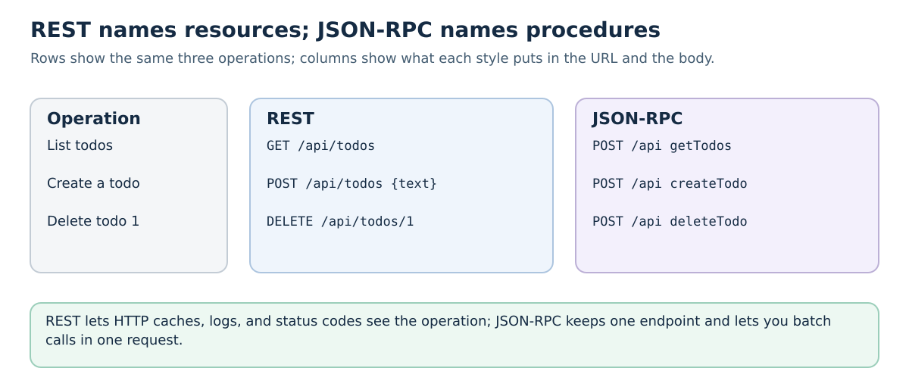
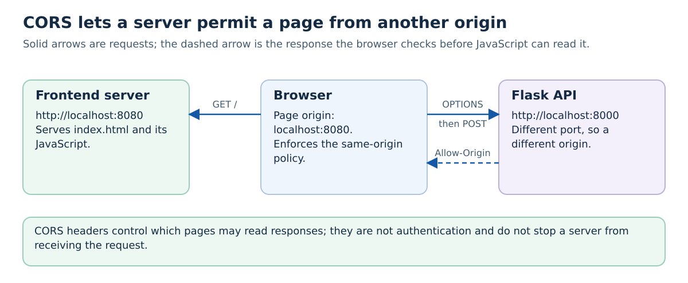
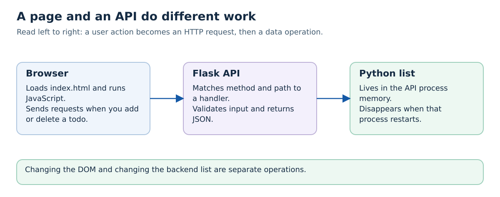
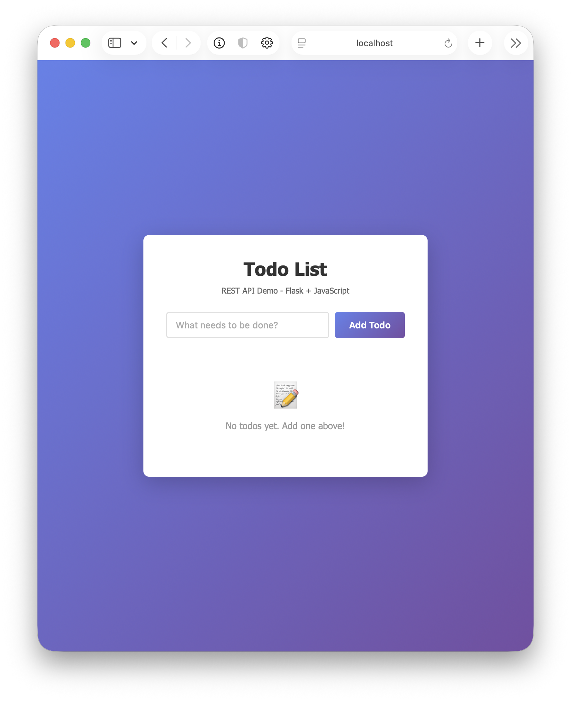
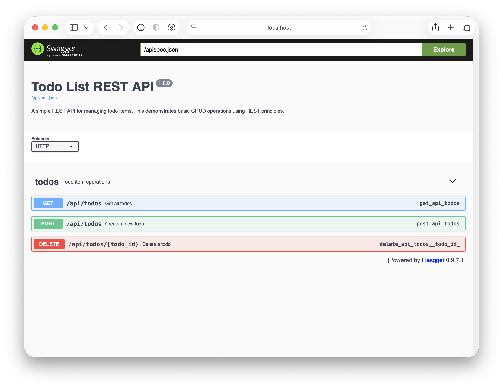

# Tutorial 1: Basic Web Application

This tutorial guides you through building a simple todo list application demonstrating fundamental web application concepts including REST APIs, client-server architecture, and frontend-backend communication.

The application includes CORS configuration for the two local development ports. First follow a request through the system below; then use the running application to check that explanation against real network messages.

## Learning Objectives

By completing this tutorial, you will understand:
- How web applications work (client-server architecture)
- The difference between REST and JSON-RPC
- How to build a REST API with Flask (Python)
- How to create a frontend that communicates with a backend
- HTTP methods and their purposes
- JSON data format
- CORS (Cross-Origin Resource Sharing)
- API documentation with Swagger/OpenAPI

---

## Why HTTP, JSON, and an API Are Different Things

Two programs need an agreed way to ask for information and interpret the reply. HTTP supplies common message semantics: a target, a method, headers, and a response status. That lets a browser, curl, and a Python client talk to a Flask server without each pair inventing a new communication protocol.

JSON addresses another question: how to represent the data inside some of those messages. An API then defines the application's meaning, such as which path creates a todo and which fields are required. Using HTTP and valid JSON does not automatically define that contract. TLS addresses yet another problem, protecting a connection; changing HTTP to HTTPS does not change the todo's data model.

**Why alternatives remain:** A static HTML page may need no data API. An interactive page needs a way to request and change application state. REST, RPC, and event-based interfaces organize that interaction differently. Learn one concrete exchange first, then compare the problem an alternative interface would solve.

## Fundamental Concepts

### 1. Client-Server Architecture

A web application typically consists of two parts:



- **Client (Frontend)**: The user interface running in the browser (HTML, CSS, JavaScript)
- **Server (Backend)**: Processes requests, handles business logic, manages data (Python, Node.js, Java, etc.)
- **Communication**: They talk via HTTP protocol using structured messages

### 2. Follow One HTTP Request

**HTTP** is an agreement about how a client asks for a resource or operation and how a server replies. Opening a page requests HTML; loading its JavaScript and images can trigger more requests. Our page also sends HTTP requests when you add or delete a todo. The browser's [HTTP overview](https://developer.mozilla.org/en-US/docs/Web/HTTP/Guides/Overview) describes the same request/response model.

Read `http://localhost:8000/api/todos` in pieces:

| Piece | Meaning in this application |
| --- | --- |
| `http` | Scheme: use HTTP without TLS for this local exercise. `https` uses TLS to protect the connection. |
| `localhost` | Host: the same computer as the program making this request. |
| `8000` | Port: where the Flask process is listening. A machine can have many servers on different ports. |
| `/api/todos` | Path: the resource Flask routes to a handler. This does not have to correspond to a file on disk. |



A **request** has a method, a target, headers, and sometimes a body. `POST /api/todos` asks our API to create a todo. `Content-Type: application/json` tells the server how to interpret the body; `{"text":"Learn HTTP"}` is the data. Flask reads that data and changes its in-memory list.

A **response** has a status code, headers, and sometimes a body. This handler returns `201 Created`, a JSON content type, and the created todo with its assigned ID. JavaScript reads the response and updates the displayed list. HTTP does not automatically update the page or save data to a database.

| Observation | What it tells you |
| --- | --- |
| `200 OK` when listing todos | The server handled the read; an empty `[]` is still a successful result. |
| `201 Created` after adding one | The API created a todo and returned it. |
| `204 No Content` after deletion | The operation succeeded and there is no JSON response body to parse. |
| `400 Bad Request` for missing text | The server received the request but rejected the input. |
| `404 Not Found` for an unknown path or todo | The requested route or resource was not found. |
| Connection refused | No process accepted the connection at that host and port; there is no HTTP status code. |

The method and status describe the message's meaning; JSON describes its data. A response can contain an application error in valid JSON. Being able to decode JSON therefore does not establish that the operation succeeded.

**Predict before running:** If the API returns `201` but you never update the DOM, will a new item appear on the page? If the backend restarts, will an in-memory todo survive? Verify both after the Quick Start.

### 3. JSON-RPC vs REST

There are different ways for clients and servers to communicate:

#### JSON-RPC (Remote Procedure Call)

**Concept**: RPC-style API where clients invoke server-side methods by name over HTTP.

**Design Philosophy**:
- **Action-oriented**: Focus on operations/methods (verbs) rather than resources (nouns)
- **Single endpoint**: All requests go to one URL (e.g., `/api` or `/rpc`)
- **Method dispatch**: Server routes requests based on the `method` field in the JSON payload
- **Transport-agnostic**: JSON-RPC specification can work over HTTP, WebSockets, TCP, etc.

**Request Format**:
```json
{
  "jsonrpc": "2.0",
  "method": "createTodo",
  "params": {"text": "Learn Flask"},
  "id": 1
}
```

**Response Format**:
```json
{
  "jsonrpc": "2.0",
  "result": {"id": 1, "text": "Learn Flask"},
  "id": 1
}
```

**Key Characteristics:**
- When used over HTTP, calls commonly use POST to a single endpoint
- Method name and parameters are in the request body, not the URL
- Supports request batching (multiple method calls in one HTTP request)
- Stateless protocol with no URL-based resource hierarchy
- Similar in spirit to Java RMI, .NET Remoting, gRPC

**When to use JSON-RPC:**
- Internal microservices communication
- APIs with complex operations that don't map well to CRUD
- When you need request batching
- Examples: Ethereum JSON-RPC API, JSON-RPC for embedded systems

#### REST (Representational State Transfer)
- **Concept**: Treat everything as a "resource" that you can manipulate
- **Style**: Resource-oriented (nouns)
- **Protocol**: Different URLs for different resources
- **Example endpoints**:
  - `GET /todos` - Retrieve todos
  - `POST /todos` - Create a new todo
  - `DELETE /todos/1` - Delete todo with id 1
  - `PUT /todos/1` - Update todo with id 1

**Characteristics:**
- Uses HTTP methods (GET, POST, PUT, DELETE) meaningfully
- URLs represent resources (nouns)
- Stateless - each request contains all needed information
- Think: "What resource am I working with?"
- Used by: Most modern web APIs (GitHub, Twitter, Stripe, etc.)

#### Comparison Example

**Same operation in both styles:**



**JSON-RPC:**
```
POST /api
Body: {"jsonrpc": "2.0", "method": "getTodos", "id": 1}

POST /api
Body: {"jsonrpc": "2.0", "method": "createTodo", "params": {"text": "Learn"}, "id": 2}

POST /api
Body: {"jsonrpc": "2.0", "method": "deleteTodo", "params": {"id": 1}, "id": 3}
```

**REST:**
```
GET /api/todos

POST /api/todos
Body: {"text": "Learn"}

DELETE /api/todos/1
```

**This tutorial uses REST** because it's the most common pattern for modern web APIs and leverages HTTP methods naturally.

### 4. HTTP Methods

REST APIs use different HTTP methods to indicate the type of operation:

| Method   | Purpose                | Example                    | Idempotent* |
|----------|------------------------|----------------------------|-------------|
| `GET`    | Retrieve data          | Get list of todos          | Yes         |
| `POST`   | Create new resource    | Create a new todo          | No          |
| `PUT`    | Update/replace resource| Update an existing todo    | Yes         |
| `DELETE` | Remove resource        | Delete a todo              | Yes         |

*Idempotent: Calling it multiple times has the same effect as calling it once

### 5. JSON Data Format

Web APIs typically exchange data in JSON (JavaScript Object Notation):

```json
{
  "id": 1,
  "text": "Learn Flask",
  "completed": false
}
```

**Why JSON?**
- Human-readable
- Easy to parse in any programming language
- Native support in JavaScript
- Lightweight compared to XML

### 6. CORS (Cross-Origin Resource Sharing)

**CORS** is a browser security mechanism that controls cross-origin HTTP requests initiated by JavaScript. An **origin** is defined by the tuple (protocol, domain, port). Different origins include:
- `http://localhost:8080` (frontend)
- `http://localhost:8000` (backend)
- `https://example.com`

**Same-Origin Policy (SOP)**: By default, browsers block JavaScript from reading responses from different origins. This limits data theft by malicious sites (e.g., `evil.com`), but does not by itself prevent requests that change state (CSRF attacks).

**CSRF (Cross-Site Request Forgery)**: A malicious site tricks the browser into sending authenticated requests to another site. Example: `evil.com` contains `<form action="https://mybank.com/transfer">` which auto-submits, causing unauthorized transfers using your session cookies.

**Why SOP helps but isn't enough:**
- `evil.com` **CAN** trigger requests to `mybank.com` (via forms, images)
- `evil.com` **CANNOT** read responses via JavaScript (SOP blocks this)
- This limits data theft but doesn't prevent state-changing operations

**CSRF Prevention**: CSRF tokens, SameSite cookies, Origin header validation, custom headers requirement.

**SOP vs CORS**: SOP blocks cross-origin access by default. CORS allows servers to selectively permit specific origins.

**Why our app needs CORS:**
- Frontend: `http://localhost:8080`, Backend: `http://localhost:8000` → Different origins
- Without CORS: Browser blocks JavaScript from reading API responses



**CORS Implementation:**

**Server (Flask)** adds headers indicating allowed origins:
```python
from flask_cors import CORS
CORS(app, resources={
    r"/api/*": {
        "origins": "*",  # Development: allow all. Production: specific domains only
        "methods": ["GET", "POST", "DELETE", "OPTIONS"],
        "allow_headers": ["Content-Type"]
    }
})
```

### 7. API Documentation with Swagger/OpenAPI

**Why API documentation matters:**
- Helps developers understand how to use your API
- Provides interactive testing without writing code
- Documents request/response formats and data types
- Serves as a contract between frontend and backend teams

**OpenAPI Specification (formerly Swagger)** is the industry standard for documenting REST APIs. It provides:
- Machine-readable API descriptions (JSON/YAML format)
- Auto-generated interactive documentation (Swagger UI)
- Code generation tools for clients and servers
- Validation and testing capabilities

**In this tutorial:**
- We use `flasgger` library to add Swagger UI to Flask
- API documentation is written as YAML in function docstrings
- Swagger UI provides a web interface at `/api-docs`
- You can test all endpoints directly from the browser

**Example OpenAPI documentation:**
```yaml
---
tags:
  - todos
parameters:
  - in: body
    name: body
    schema:
      type: object
      properties:
        text:
          type: string
```

---

## Application Architecture

Our simple todo list application:



The browser controls what is displayed, while Flask owns the list the API returns. The arrows trace a data operation, not three separate machines: both servers can run on your laptop. This separation lets a different client use the same API. Persistence is still absent because the last stage is only a Python list.

**Check your reasoning:** After creating a todo, reload the page and then restart Flask. Which action loses the stored item, and why?


**Data Flow Example - Adding a Todo:**

1. User types "Learn Flask" and clicks "Add"
2. JavaScript captures the event
3. JavaScript sends: `POST /api/todos` with body `{"text": "Learn Flask"}`
4. Flask receives request, creates todo with unique ID
5. Flask responds: `{"id": 1, "text": "Learn Flask"}`
6. JavaScript receives response, updates the page

---

## Project Structure

```
01-basic-webapp/
├── README.md              # This file
├── backend/
│   ├── app.py            # Flask server (REST API)
│   └── requirements.txt  # Python dependencies
└── frontend/
    └── index.html        # Complete frontend (HTML + CSS + JS)
```

---

## Prerequisites

- Python 3.10 or higher
- pip (Python package manager)
- A web browser
- A text editor

---

## Quick Start

These commands start two different local processes. The backend on port 8000 handles todo data; the file server on port 8080 delivers HTML and JavaScript. Keep both terminals open. Use [the command guide](../COMMANDS.md) if `cd`, `source`, or `-m` is unfamiliar.

#### Step 1: Set Up and Run the Backend

```bash
# From the repository root, navigate to the backend directory
cd 01-basic-webapp/backend

# Create and activate an isolated environment (Windows: .venv\Scripts\activate)
python3 -m venv .venv
source .venv/bin/activate

# Install dependencies (first time only)
python3 -m pip install -r requirements.txt

# Run the Flask server
python3 app.py
```

You should see:
```
Starting Flask server...
API will be available at: http://localhost:8000
```

The backend is now running! Keep this terminal open.

`python3 -m venv .venv` creates a directory containing an isolated Python environment. `source` activates it in this shell. `pip install -r` reads the dependency list; it does not start the application. `python3 app.py` starts Flask and waits for requests. You can confirm this independently of the frontend by opening `http://localhost:8000/api/todos`.

#### Step 2: Serve the Frontend from an HTTP Server

**Recommended method** - Use a local HTTP server:

```bash
# Open a new terminal at the repository root
cd 01-basic-webapp/frontend

# Python 3 - starts HTTP server on port 8080
python3 -m http.server 8080

# Then visit http://localhost:8080 in your browser
```

This runs a simple HTTP server that serves your frontend files. Your browser will load `index.html` from `http://localhost:8080`, which then makes requests to the backend API at `http://localhost:8000`.

**Alternative** - Open the file directly (may have limitations):
- You can also open `frontend/index.html` directly in your browser (using `file://` protocol)
- This works for this simple tutorial, but using an HTTP server is the proper way and more closely mimics real-world deployments



---

## Swagger API Documentation

This tutorial includes **Swagger UI**, an interactive tool that renders the API specification and lets you test the API from your browser.

### What is Swagger/OpenAPI?

**OpenAPI** is an API description standard that originated from the Swagger specification. Flasgger uses a Swagger 2.0 specification in this example, and Swagger UI renders it. These tools provide:
- **Interactive documentation**: See all available endpoints, their parameters, and response formats
- **Try it out**: Test API endpoints directly from the browser without writing code
- **Schema validation**: Understand the expected request/response structure
- **Industry standard**: Used by companies like Google, Microsoft, Stripe, etc.

### Accessing Swagger UI

Once your backend is running, open:
```
http://localhost:8000/api-docs
```

You'll see an interactive interface showing all your API endpoints.



### Using Swagger UI

1. **Explore endpoints**: Click on any endpoint (GET, POST, DELETE) to expand it
2. **See details**: View parameters, request body schema, and possible responses
3. **Try it out**:
   - Click the "Try it out" button
   - Fill in any required parameters or request body
   - Click "Execute" to send a real request to your API
   - See the actual response below
4. **View examples**: Each endpoint shows example requests and responses

**Example - Creating a todo via Swagger:**
1. Open `http://localhost:8000/api-docs`
2. Find the `POST /api/todos` endpoint and click it
3. Click "Try it out"
4. Edit the request body JSON:
   ```json
   {
     "text": "Learn Swagger"
   }
   ```
5. Click "Execute"
6. See the response with the created todo including its assigned ID

This is a great way to test your API without needing to use the frontend or write curl commands!

---

## Test the Application

### Inspect the Protocol Yourself

With the backend running, use another terminal. Predict the status code and response body for each command before running it:

```bash
curl -i http://localhost:8000/api/todos

curl -i -X POST http://localhost:8000/api/todos \
  -H 'Content-Type: application/json' \
  -d '{"text":"Learn HTTP"}'

curl -i -X POST http://localhost:8000/api/todos \
  -H 'Content-Type: application/json' \
  -d '{}'
```

`curl` is an HTTP client. `-i` includes response headers, making the status code visible. `-X POST` selects the method, `-H` adds a request header, and `-d` supplies the body. The backslashes continue a single command across lines. The first command reads data; the second changes the server's list; the third should be rejected with `400`.

Open the browser's **Network** tab, add a todo through the page, and inspect the matching request. Find the method, URL, request body, status code, response headers, and response body. The request resembles the one sent by curl because both clients speak HTTP. For a JSON request from the other origin, you may also see an `OPTIONS` CORS preflight before `POST`.

**Explain your observations:** Why does an empty list return `200`, while an invalid create request returns `400`? Stop the backend and repeat the first command: why is that failure different from `404`? Restart it and inspect the list again: which process was storing the todos?

### Exercise the User Interface

1. **Add a todo**: Type something in the input box and click "Add Todo"
2. **View todos**: Your todos appear in a list below
3. **Delete a todo**: Click the "Delete" button next to any todo
4. **Check the API directly**:
   - Raw JSON: `http://localhost:8000/api/todos`
   - Swagger UI: `http://localhost:8000/api-docs` (interactive testing)

### Debugging Tip

**Open the browser developer console** to see network requests, JavaScript errors, and CORS issues:

- **Chrome**: Press `F12` or `Cmd+Option+J` (Mac) / `Ctrl+Shift+J` (Windows/Linux)
- **Safari**: Enable Developer menu in Preferences → Advanced, then press `Cmd+Option+C`
- **Firefox**: Press `F12` or `Cmd+Option+K` (Mac) / `Ctrl+Shift+K` (Windows/Linux)

In the console, you can:
- View **Network** tab to see HTTP requests/responses and status codes
- View **Console** tab to see JavaScript errors and `console.log()` output
- Inspect CORS errors and other API issues

---

## How It Works

### Backend (Flask) - `backend/app.py`

The Flask server provides three endpoints:

**1. GET /api/todos - Retrieve all todos**
```python
@app.route('/api/todos', methods=['GET'])
def get_todos():
    return jsonify(todos)
```
- Returns the entire list of todos as JSON

**2. POST /api/todos - Create a new todo**
```python
@app.route('/api/todos', methods=['POST'])
def create_todo():
    global next_id
    data = request.get_json(silent=True)
    if not isinstance(data, dict) or 'text' not in data:
        return jsonify({'error': 'Missing text field'}), 400
    if not isinstance(data['text'], str) or not data['text'].strip():
        return jsonify({'error': 'Text must be a non-empty string'}), 400
    new_todo = {
        'id': next_id,
        'text': data['text'].strip()
    }
    todos.append(new_todo)
    next_id += 1
    return jsonify(new_todo), 201
```
- Receives JSON data from the client
- Creates a new todo with a unique ID
- Adds it to the list
- Returns the created todo with status code 201 (Created)

**3. DELETE /api/todos/<id> - Delete a todo**
```python
@app.route('/api/todos/<int:todo_id>', methods=['DELETE'])
def delete_todo(todo_id):
    global todos
    if not any(t['id'] == todo_id for t in todos):
        return jsonify({'error': 'Todo not found'}), 404
    todos = [t for t in todos if t['id'] != todo_id]
    return '', 204
```
- Filters out the todo with the specified ID
- Returns status code 404 if the todo does not exist, otherwise an empty response with status code 204 (No Content)

### Frontend (JavaScript) - `frontend/index.html`

The JavaScript code uses the **Fetch API** to communicate with the backend:

**Fetching todos:**
```javascript
fetch('http://localhost:8000/api/todos')
    .then(response => response.json())
    .then(data => {
        // Update the UI with the todos
    });
```

**Creating a todo:**
```javascript
fetch('http://localhost:8000/api/todos', {
    method: 'POST',
    headers: {
        'Content-Type': 'application/json'
    },
    body: JSON.stringify({ text: todoText })
})
```

**Deleting a todo:**
```javascript
fetch(`http://localhost:8000/api/todos/${todoId}`, {
    method: 'DELETE'
})
```

---

## Understanding the Code

### Key Concepts in `app.py`:

1. **Flask initialization**:
   ```python
   from flask import Flask, request, jsonify
   from flask_cors import CORS

   app = Flask(__name__)
   CORS(app)  # Enable CORS for all routes - allows frontend on different origin to access API
   ```
   - `Flask(__name__)`: Creates the Flask application
   - `CORS(app)`: Enables Cross-Origin Resource Sharing - crucial for allowing your frontend (on one port) to communicate with your backend (on another port)

2. **Route decorators**: `@app.route('/path', methods=['GET', 'POST'])`
   - Define URL endpoints
   - Specify which HTTP methods are allowed

3. **Request handling**: `request.json`
   - Access data sent by the client

4. **Response formatting**: `jsonify(data)`
   - Convert Python dictionaries/lists to JSON
   - Sets proper `Content-Type: application/json` headers

5. **In-memory storage**: `todos = []`
   - Simple list to store data
   - Data is lost when server restarts
   - In real apps, you'd use a database

### Key Concepts in `index.html`:

1. **DOM manipulation**:
   ```javascript
   document.getElementById('todoInput')
   ```

2. **Event listeners**:
   ```javascript
   form.addEventListener('submit', handleSubmit)
   ```

3. **Fetch API** - Modern way to make HTTP requests:
   ```javascript
   fetch(url, options)
       .then(response => response.json())
       .then(data => { /* use data */ })
   ```

4. **Async operations** - Web requests are asynchronous:
   - Promises (`.then()` chains)
   - Request is sent, code continues
   - When response arrives, callback is executed

---

## Common Issues and Solutions

### Issue 1: CORS Error
**Error**: "Access to fetch has been blocked by CORS policy"

**Cause**: The browser blocks requests from the frontend to the backend because they're on different origins (different ports/domains).

**Solution**: This app already has Flask-CORS configured! Make sure:
1. Flask-CORS is installed: `python3 -m pip install -r requirements.txt`
2. The backend server is running: `python3 app.py`

The code already includes:
```python
from flask_cors import CORS
CORS(app)  # This allows cross-origin requests
```

### Issue 2: Connection Refused / Failed to Fetch
**Error**: "Failed to fetch" or "Connection refused"

**Solution**:
- Ensure Flask server is running on port 8000 (`python3 app.py` in backend directory)
- Check that the backend URL in `frontend/index.html` is correct:
  ```javascript
  const API_URL = 'http://localhost:8000/api/todos';
  ```
- Try accessing `http://localhost:8000` directly in your browser to verify the server is running

### Issue 3: Port Already in Use
**Error**: "Address already in use"

**Cause**: Another application is already using port 8000. (Note: On macOS, port 5000 is used by AirPlay Receiver, which is why we use 8000 instead)

**Solution**:
If you encounter port conflicts on port 8000:

```bash
# On macOS/Linux - Find process using port 8000
lsof -i :8000
# Kill the process
kill -9 <PID>

# On Windows
netstat -ano | findstr :8000
taskkill /PID <PID> /F
```

Or change to a different port in `backend/app.py`:
```python
app.run(debug=True, port=8001)  # Change to any available port
```

Then update the frontend `API_URL` to match:
```javascript
const API_URL = 'http://localhost:8001/api/todos';  // Update port
```

### Issue 4: Module Not Found Error
**Error**: "ModuleNotFoundError: No module named 'flask'" or "No module named 'flask_cors'"

**Solution**:
```bash
cd backend
python3 -m pip install -r requirements.txt
```

## Next Steps

After completing this tutorial:

1. **Add a database**: Replace in-memory list with PostgreSQL (see Tutorial 8)
2. **Containerize with Docker**: Package your app in containers (Tutorial 2)
3. **Learn about databases**: Understand different database types (Tutorial 3)
4. **Deploy to Kubernetes**: Set up the cluster and deploy an application (Tutorials 6-7)
5. **Add authentication**: Protect your API with user login
6. **Build a more complex app**: User accounts, multiple resources, relationships

---

## Additional Resources

- [Flask Documentation](https://flask.palletsprojects.com/)
- [MDN Web Docs - Fetch API](https://developer.mozilla.org/en-US/docs/Web/API/Fetch_API)
- [REST API Tutorial](https://restfulapi.net/)
- [HTTP Status Codes](https://developer.mozilla.org/en-US/docs/Web/HTTP/Status)
- [OpenAPI Specification](https://swagger.io/specification/)
- [Flasgger Documentation](https://github.com/flasgger/flasgger)
