# Tutorial 4b: Software Architectures

A guide to the architectural styles you will meet when building web systems, what each one is for, and what it costs.

## Why Architecture Is a Separate Decision from Frameworks

[Tutorial 4](../04-frameworks/README.md) compared tools: React or Svelte, Flask or FastAPI. Those choices decide how code is written. An **architecture** decides how the code is divided, which parts may depend on which, where data lives, and which parts are deployed, scaled, and released together. You can build a clean modular monolith in Flask and a tangled distributed system in the newest framework.

Architecture is mostly about **change and failure**. Which change should be cheap: a new database, a new client, a new team, ten times more traffic? What should keep working when one part fails? No style makes every change cheap. Each one makes some changes easier by making others harder, and each adds parts that must be understood and operated.

This tutorial uses the todo application from [Tutorial 1](../01-basic-webapp/README.md) as a running example. Its API is small (`GET /api/todos`, `POST /api/todos`, `DELETE /api/todos/<id>`), which makes the cost of each style easy to see: for an application that size, most of the styles below would be too much. The point is to recognize the problem each style answers, so that you choose it when that problem actually appears.

## Learning Objectives

By the end of this tutorial, you will be able to:
- Explain the problems addressed by layers, MVC, modular monoliths, ports and adapters, services, events, pipelines, plug-ins, CQRS, BFFs, serverless, and real-time delivery
- Name what you give up with each style and recognize when not to use it
- Distinguish code boundaries (layers, modules, ports) from runtime boundaries (processes, services, functions)
- Explain Conway's law and use the twelve-factor principles as a checklist for deployable services
- Describe an incremental path from a monolith to services and the evidence that justifies each step
- Recognize that real systems combine styles, for example a microservice that is internally hexagonal

## Prerequisites

- Completed Tutorials 1-4, in particular the HTTP request flow in Tutorial 1 and the framework roles in Tutorial 4
- Basic Python and Flask syntax

This is a conceptual tutorial. The code snippets are short illustrations, not a runnable project. Imports, error handling, and configuration are omitted where they would hide the structure being discussed. Completion state, owners, reminders, and due dates are hypothetical extensions; Tutorial 1 currently stores only `id` and `text`. These sketches do not add endpoints to that supplied application.

## How to Read Each Section

Each main architecture section ends with the same three questions:

| Question | What it asks |
| --- | --- |
| **Solves** | Which concrete problem makes this style worth its cost? |
| **You give up** | What becomes harder, slower, or more expensive? |
| **Avoid when** | Which situations make the cost larger than the benefit? |

Before reading each section, **predict**: if the todo app were built this way, which files or processes would change when you add a "due date" field? Afterwards, check your prediction against the figure. A good answer to "which architecture should we use?" names the change or failure you are designing for.

## Separate the Questions Before Choosing

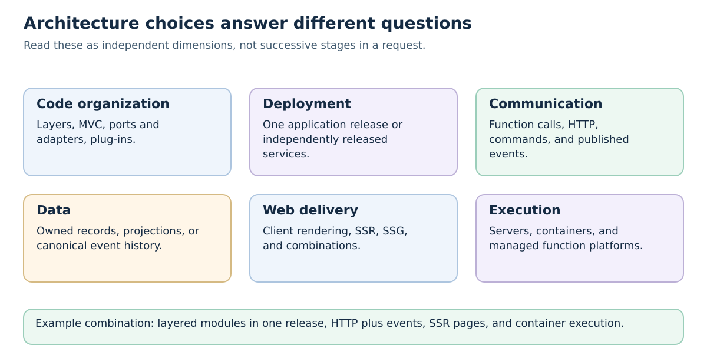

| Question | Example choices | What it does not determine |
| --- | --- | --- |
| How is code organized? | Layers, MVC, ports and adapters, plug-ins | The number of servers. |
| What is released independently? | One modular application, several services | Which UI library is used. |
| How do parts communicate? | Function calls, HTTP, commands, events | Who owns the data or handles retries. |
| What is stored and read? | Current records, projections, event history | Whether updates are immediately visible everywhere. |
| How is the first page produced? | Client rendering, SSR, SSG, a hybrid | Whether the backend is a monolith. |
| Who manages execution? | Servers, containers, managed functions | The business boundaries and correctness rules. |

A layered modular monolith can render HTML on the server and publish events. A microservice can use ports and adapters internally, and a serverless platform can host several application designs. **SPA/SSR/SSG** describe delivery and interaction choices covered in [Tutorial 4](../04-frameworks/README.md#spa-vs-ssr-application-architecture-patterns); they are not alternatives to microservices. Microsoft's [architecture styles overview](https://learn.microsoft.com/azure/architecture/guide/architecture-styles) provides another map of structural choices.

Whenever you draw a box, label it as a module, process, service, database, or replica. Whenever you draw an arrow, say whether it is a code dependency, runtime call, data flow, or passage of time.

## Two Threads Through Every Style

### Conway's Law

In 1968 Melvin Conway observed that organizations design systems whose structure copies their own communication structure. If three teams build a compiler, you tend to get a three-pass compiler. For web systems this means service and module boundaries usually end up where team boundaries are, whether or not that was the plan.

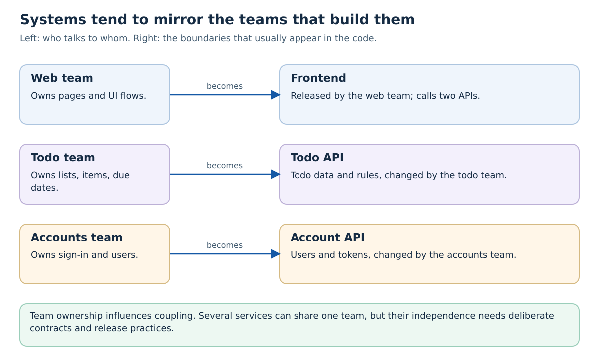

Two practical consequences:
- **An architecture that contradicts the team structure tends to erode.** If one team owns several services, ask whether the boundaries allow useful independent changes. One team can operate independent services, but separate names alone do not create independence.
- **You can use the law deliberately** (sometimes called the inverse Conway manoeuvre): choose team responsibilities to match the boundaries you want. In this course, your project group is one team, which is a strong hint about how many independently owned services you really need.

### The Twelve-Factor App

The [Twelve-Factor App](https://12factor.net/), published by Heroku engineers in 2011, lists practices that make an application easy to deploy and scale on a cloud platform. It applies to a monolith as much as to a microservice, and provides useful practices for the containers used in later tutorials. These are design guidelines, not prerequisites enforced by Kubernetes:

| Factor | In this course |
| --- | --- |
| Codebase, dependencies | Keep each application's code and dependencies identifiable, even in a monorepo; dependencies declared in `requirements.txt` or `package.json`, not assumed on the host |
| Config | Database URLs and secrets come from environment variables (Tutorial 2), not from code |
| Backing services | PostgreSQL, MongoDB, and RabbitMQ are attached resources addressed by URL |
| Build, release, run | A Docker image is built once and the same image runs in every environment |
| Processes, concurrency | Keep durable shared state outside disposable application instances; scale suitable work with replicas (Tutorial 5) |
| Port binding, disposability | The app serves HTTP on a port, starts fast, and shuts down cleanly when Kubernetes stops it |
| Dev/prod parity, logs | Compose and Kubernetes run the same images; logs go to stdout |
| Admin processes | Migrations run as one-off jobs with the same code and config |

Use this table to review deployment behavior. These practices support disposability and scaling; the application still needs the matching implementation and operational configuration.

## 1. Layered (N-Tier) Architecture

A **layered** application splits code by technical responsibility. The classic three layers are:

- **Presentation:** receives HTTP requests or renders views, and turns results into responses
- **Business (domain, service) layer:** the rules, for example "todo text must not be empty" or "only the owner may delete a todo"
- **Data access:** stores and retrieves records

In a strict layered design, each layer calls only the layer directly below it; other variants allow a layer to call lower layers directly. A conventional three-tier web deployment has a browser, application server, and database server. This is a different view from the layers inside the backend.

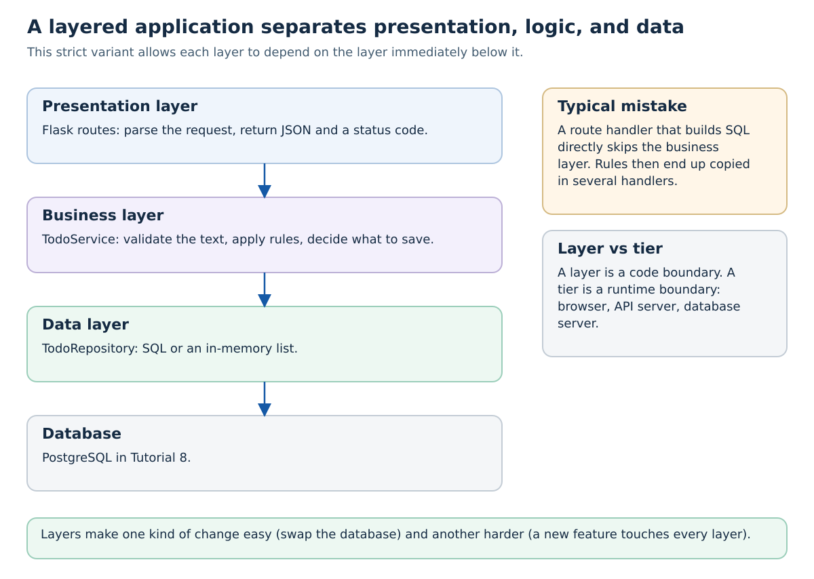

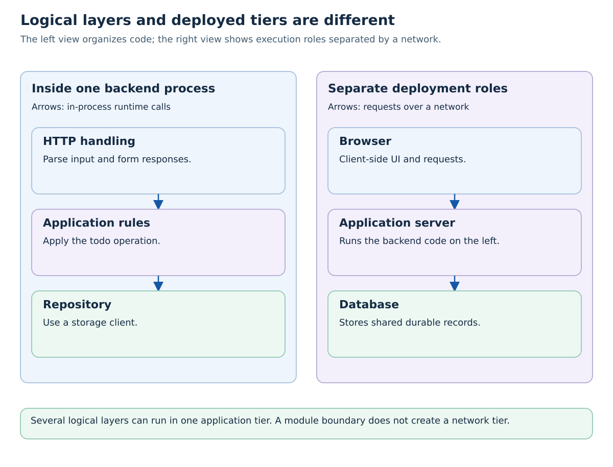

A **layer** is a responsibility in code; a **tier** here is a separately deployed execution role, commonly separated by a network. Several layers can share one tier. Creating three files does not create three machines. See the [N-tier discussion of logical layers and physical tiers](https://learn.microsoft.com/azure/architecture/guide/architecture-styles/n-tier).

The Tutorial 1 backend puts everything in route handlers. Layering it looks like this:

```python
# presentation: HTTP only
@app.route('/api/todos', methods=['POST'])
def create_todo():
    try:
        data = request.get_json(silent=True)
        if not isinstance(data, dict):
            raise ValueError('expected a JSON object')
        todo = todo_service.create(data.get('text', ''))
    except ValueError as error:
        return jsonify({'error': str(error)}), 400
    return jsonify(todo), 201

# business: rules, no Flask, no SQL
class TodoService:
    def __init__(self, repository):
        self.repository = repository

    def create(self, text):
        if not isinstance(text, str) or not text.strip():
            raise ValueError('text must be a non-empty string')
        return self.repository.add({'text': text.strip()})

# data access: storage only
class TodoRepository:
    def __init__(self):
        self.todos = []
        self.next_id = 1

    def add(self, todo):
        todo = {**todo, 'id': self.next_id}
        self.next_id += 1
        self.todos.append(todo)
        return todo
```

The route no longer knows how todos are stored, and the rule about empty text lives in one place. If the repository contract remains suitable, PostgreSQL can implement it without changing that validation rule. Database configuration, transactions, and integration tests still need work.

The weakness shows when you add a feature. A "due date" touches all three layers, and in a large layered codebase every feature is spread across a `controllers/`, a `services/`, and a `repositories/` folder that many people edit at once. Another common failure is the **sinkhole**: service methods that only forward calls to the repository, adding files without adding rules.

> **Solves:** mixing HTTP, rules, and SQL in one function; makes storage and presentation replaceable.
> **You give up:** features cut across every layer; layers can become pass-through ceremony.
> **Avoid when:** extra pass-through layers add no useful boundary. In a larger system, consider business modules (section 3) with useful layers inside each module.

## 2. MVC, MVVM, and Component-Based UIs

These patterns organize code **inside one application**, usually its user interface.

- **Model-View-Controller (MVC)** was described by Trygve Reenskaug for Smalltalk in 1979. The model holds data and rules, the view displays it, and the controller handles input and decides what to update. Server-side web frameworks adopted it: in Flask with templates, a route acts as the controller, domain objects and business behavior form the model, and a Jinja template is the view. Django and Ruby on Rails are built around variants of it.
- **Model-View-ViewModel (MVVM)** came from Microsoft's WPF work around 2005. The view model exposes state and commands, and the view **binds** to them so it updates automatically when the state changes. Vue's reactive data and Angular's templates follow this idea.
- **Component-based UIs**, as in React and Svelte, group a piece of view with its state and behavior into a reusable component. Data flows down through props and events flow up through callbacks. A `TodoList` component renders `TodoItem` components and passes each one a todo and an `onDelete` callback.

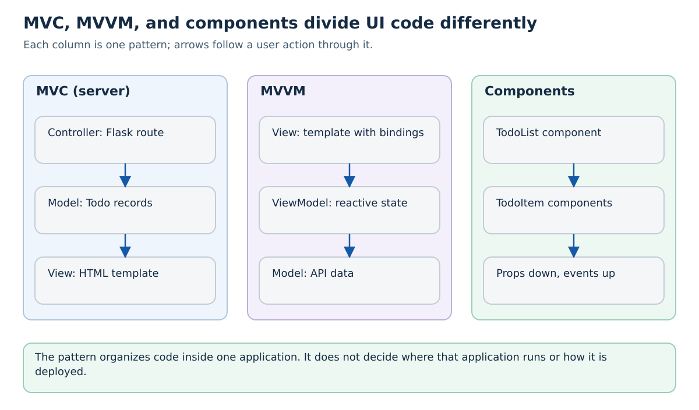

In the todo app, the vanilla JavaScript frontend from Tutorial 1 mixes everything in event handlers. In the React version from [Tutorial 9](../09-claude-code-frontend/README.md), the list, each item, and the input form are components, and the todo array is state held by a parent component.

These patterns say nothing about deployment or service boundaries. An application is not "MVC instead of microservices"; each microservice and each frontend has its own internal structure.

> **Solves:** UI code where display, input handling, and data are tangled together and hard to test or reuse.
> **You give up:** some indirection; with MVVM and reactive frameworks, update behavior becomes implicit and can be hard to trace.
> **Avoid when:** a page with one form does not need a pattern; follow your framework's convention rather than inventing your own layering on top of it.

## 3. Modular Monolith

A **monolith** is an application released as one deployable unit; it can have several replicas or supporting worker processes and use more than one datastore. That is a deployment property, not a quality judgement. A **modular monolith** is a monolith whose code is divided into business modules, such as `todos`, `users`, and `notifications`, with enforced rules:

- Each module exposes a small public interface, for example `todos.create_todo()` and `todos.list_todos()`
- Each module owns its tables; other modules never query them directly
- Other modules may import only the public interface, never internal files

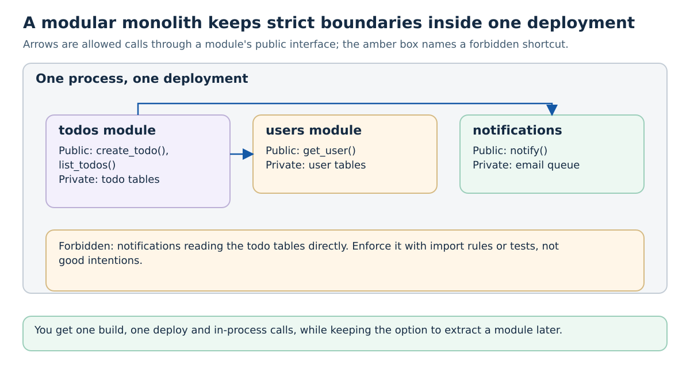

```text
todo_app/
  todos/
    __init__.py      # public: create_todo, list_todos, complete_todo
    _service.py      # private
    _repository.py   # private, the only code that touches the todos table
  users/
    __init__.py      # public: get_user
    ...
  notifications/
    __init__.py      # public: notify
    ...
  app.py             # wires modules to Flask routes
```

The boundaries need enforcement, otherwise they disappear under deadline pressure. Options include an import-linting tool such as `import-linter` for Python, a test that fails when one module imports another's private files, and code review rules. Shopify's large Rails monolith is a well-known example of this approach; they enforce component boundaries with tooling rather than splitting everything into services.

Calls between modules in one process avoid network transport and remote-response ambiguity. They can still raise exceptions, block on I/O, or call a slow dependency. A shared database can support a transaction across modules when their ownership rules allow it, and application releases stay together. If one module later needs independent deployment, its public interface is already the natural API for a service.

> **Solves:** a growing codebase where every change breaks something elsewhere, without paying for distributed systems.
> **You give up:** everything is released together; one module cannot scale or use another language on its own; a crash or memory leak affects all modules.
> **Avoid when:** parts genuinely need separate release cycles, separately owned teams, or very different capacity (then see section 5).

## 4. Hexagonal Architecture (Ports and Adapters)

Alistair Cockburn described **hexagonal architecture**, also called **ports and adapters**, in 2005. It changes the direction of dependencies compared with plain layering. The business **core** does not depend on Flask or PostgreSQL. Instead, the core defines **ports**, interfaces describing what it needs or offers, and the outside world provides **adapters**:

- **Driving adapters** call into the core: an HTTP route, a command-line tool, a test
- **Driven adapters** implement ports the core needs: a PostgreSQL repository, an email sender, an in-memory fake

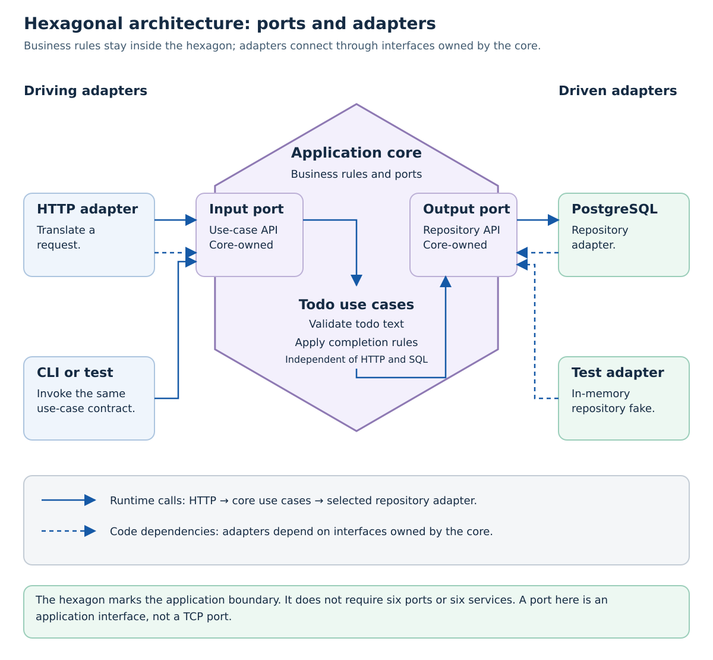

A **port** means an application interface here, not a TCP port. The hexagon is a drawing convention, not a requirement to create six interfaces. At runtime a use case calls its repository adapter; at the source-code level that adapter implements a port defined by the core. Keeping these two arrow meanings separate explains dependency inversion.

```python
# core/ports.py: what the core needs, in its own terms
from typing import Protocol

class TodoRepository(Protocol):
    def add(self, text: str) -> dict: ...
    def get(self, todo_id: int) -> dict | None: ...
    def save(self, todo: dict) -> None: ...

# core/service.py: rules only; imports nothing from Flask or a database driver
class TodoService:
    def __init__(self, repository: TodoRepository):
        self.repository = repository

    def complete(self, todo_id: int) -> dict:
        todo = self.repository.get(todo_id)
        if todo is None:
            raise LookupError(f'todo {todo_id} not found')
        if todo['done']:
            return todo  # completing twice is harmless
        todo['done'] = True
        self.repository.save(todo)
        return todo

# adapters/postgres.py: implements the port with SQL
class PostgresTodoRepository:
    def __init__(self, connection):
        self.connection = connection

    def get(self, todo_id):
        ...  # SELECT ... WHERE id = %s

# adapters/http.py: drives the core from Flask
@app.route('/api/todos/<int:todo_id>/complete', methods=['POST'])
def complete(todo_id):
    try:
        return jsonify(service.complete(todo_id))
    except LookupError:
        return jsonify({'error': 'not found'}), 404

# tests: a fake adapter, no database or HTTP server needed
class InMemoryTodoRepository:
    def __init__(self):
        self.todos = {}
    ...

def test_complete_twice_is_harmless():
    service = TodoService(InMemoryTodoRepository())
    ...
```

A practical benefit is testing business behavior without starting HTTP servers or a real database. Integration tests still need to check that real adapters satisfy the same contract. This connects directly to [Tutorial 10](../10-testing-ci/README.md).

**Clean Architecture** and **Onion Architecture** are related approaches to keeping business behavior independent of technical details. They differ in terminology and structure; they are not exact synonyms. Martin's [Clean Architecture article](https://blog.cleancoder.com/uncle-bob/2012/08/13/the-clean-architecture.html) describes source-code dependencies pointing toward inner policies. The core must still define useful behavior rather than merely forwarding every call.

> **Solves:** business rules tied to a framework or database, which makes them slow to test and expensive to migrate.
> **You give up:** more interfaces and wiring code; a newcomer must learn where things live; mapping between core objects and database or HTTP shapes.
> **Avoid when:** the service is mostly CRUD with almost no rules; a thin layered Flask app is clearer. Use ports where a dependency is actually likely to change or needs faking in tests.

## 5. Microservices

**Microservices** make module boundaries into process and network boundaries. Each service owns a business responsibility and its data, exposes an API or events, and is deployed independently. [Tutorial 5](../05-microservices-and-k8s/README.md) covers the style in depth: service boundaries, database per service, the API gateway, discovery, and running services on Kubernetes. This section only places it among the other styles.

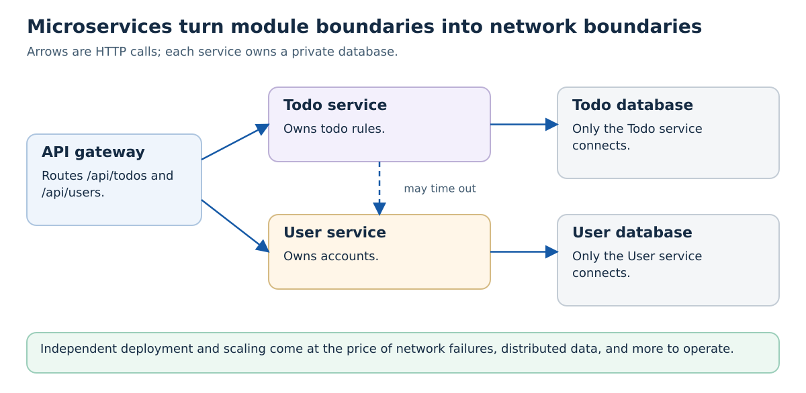

For the todo app, the split would be a Todo service and a User service behind a gateway. Notice what changes compared with the modular monolith in section 3. `users.get_user()` was a function call; now it is an HTTP request that can be slow, fail, or succeed without a response arriving. Showing a todo with its owner's name is no longer a SQL join; it is two calls or a copy of user data in the Todo service. Each service needs its own image, pipeline, monitoring, and on-call knowledge.

The benefit is independence: the Todo team can release ten times a day without coordinating with the User team, and the service that gets heavy traffic can scale alone. That benefit only exists if boundaries match responsibilities and teams. Services that must always be released together, or that freely modify each other's private tables, risk becoming a **distributed monolith**: the cost of services with the coupling of a monolith.

Separate physical database servers and different programming languages are not requirements. Data ownership and compatible interfaces matter even when services share a database platform or repository.

> **Solves:** teams blocking each other's releases; parts with very different scaling or technology needs.
> **You give up:** in-process calls and transactions; simple debugging; you gain network failure handling, data consistency work, and much more to operate.
> **Avoid when:** one small team, unclear domain boundaries, or no operational maturity yet. Start with a modular monolith (see "Evolve, Don't Pick Up Front").

## 6. Event-Driven Architecture

In a request-driven design, the Todo service would call the Stats service, the Notification service, and the Search service every time a todo is completed, and it would need to know all three. In an **event-driven** design, the Todo service publishes an event, `TodoCompleted`, to a broker, and any interested service subscribes. The producer does not know who listens, and new consumers can be added without changing it. [Tutorial 14](../advanced/14-service-communication/README.md) shows the mechanics with RabbitMQ: queues, acknowledgments, publish/subscribe, and dead-letter queues.

An event describes something that **has happened**, named in the past tense. That distinguishes it from a command (`SendEmail`), which asks one specific receiver to do something.

Martin Fowler's article [What do you mean by "Event-Driven"?](https://martinfowler.com/articles/201701-event-driven.html) separates two common uses that look similar but behave very differently:

- **Event notification:** the event is small, `{"type": "TodoCompleted", "id": 42}`. A consumer that needs details calls the producer's API. Data stays in one place, but consumers depend on the producer being up when they handle the event.
- **Event-carried state transfer:** the event contains the changed data: title, owner, completion time. Consumers keep their own copy and never call back, so they can handle that event without calling back for those fields. The cost is larger events, duplicated data, and copies that are briefly out of date.

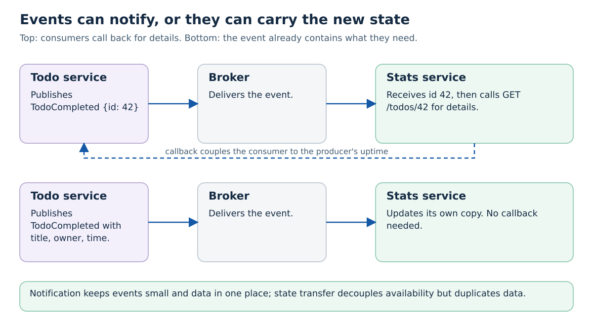

Separate subscribers need separate queues or subscriptions if each should receive a copy. Multiple workers on one queue normally compete for deliveries; that is a work queue, not a broadcast to every worker. A broker accepting a message and a consumer completing an action are different outcomes.

Event-driven systems change how you reason about correctness:

- **Eventual consistency:** after a todo is completed, the Stats service shows the new count a moment later, not immediately
- **At-least-once delivery:** brokers may deliver an event twice, so consumers must be **idempotent**; processing `TodoCompleted 42` twice must not count it twice
- **Ordering:** events about the same todo can arrive out of order unless you design for it
- **Publishing reliably:** if the service saves to its database and then crashes before publishing, the event is lost. The **outbox pattern** writes the event to an outbox table in the same transaction and publishes it afterwards with retry and duplicate handling
- **Visibility:** the flow of one business operation is spread over several consumers; correlation IDs in logs, tracing, and the metrics from [Tutorial 15](../advanced/15-monitoring/README.md) become important

> **Solves:** a producer that must know and call every interested party; consumers that must keep working while others are down; absorbing load spikes in a queue.
> **You give up:** immediate consistency; a single place to read the whole flow; you must handle duplicates, ordering, and lost events.
> **Avoid when:** the caller needs the answer to continue (use a request), or asynchronous delivery adds no useful buffering or decoupling. A single consumer can still benefit from a work queue.

## 7. CQRS and Event Sourcing

These two patterns are often presented together, but they are separate decisions.

**Command Query Responsibility Segregation (CQRS)**, named by Greg Young around 2010, uses different models for changing data and for reading it. Commands such as `CompleteTodo` go to a write model that enforces rules. Queries go to **read models**, tables or documents shaped for one screen, such as "number of open todos per user". CQRS does not require separate databases, separate processes, events, or asynchronous updates. If a separate read model is updated asynchronously by a **projector**, readers can briefly see old data.

**Event sourcing** stores every change as an event in an append-only **event store** (`TodoCreated`, `TodoRenamed`, `TodoCompleted`) instead of storing only the current row. The current state is derived by replaying the events. You get a complete history and can build new read models later by replaying old events.

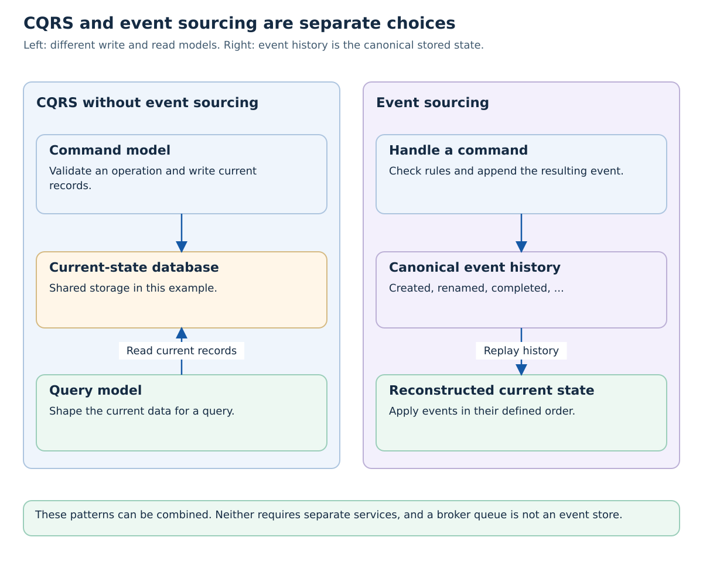

You can use CQRS without event sourcing, for example a normal PostgreSQL write model plus a denormalized search index. Event sourcing can also reconstruct current state for ordinary queries without introducing independently deployed read services. A RabbitMQ queue is a delivery mechanism; it is not automatically the canonical, replayable event store.

Keeping historical events readable makes schema evolution and retention deliberate design work. Storing sensitive data in a durable history also makes deletion and access control more complex. Readers of asynchronously maintained projections may briefly see older data. Fowler's [CQRS article](https://martinfowler.com/bliki/CQRS.html) warns that for most systems CQRS adds risky complexity.

> **Solves:** reads and writes with very different shapes or load; a real requirement for an audit trail or for rebuilding state at a past point in time (banking ledgers, order histories, collaborative editing).
> **You give up:** simple CRUD and easy history changes; asynchronous projections also need a read-after-write consistency strategy.
> **Avoid when:** ordinary CRUD already meets the requirement. A current-state database with an audit table may provide sufficient history without making the event log canonical.

## 8. Backend for Frontend (BFF)

A web dashboard, a mobile app, and a smartwatch need different data from the same services. The mobile home screen wants "3 open todos, next due: buy milk" in one small response; the web dashboard wants full lists with filters and user details. If every client calls the general services directly, the mobile app makes many round trips over a slow network and downloads data it throws away.

A **Backend for Frontend**, a pattern described by [Sam Newman](https://samnewman.io/patterns/architectural/bff/) and popularized by SoundCloud, gives each kind of client its own thin backend. The BFF calls the general services, combines the results, and returns exactly the shape that client needs. It is usually owned by the team that builds the client, so they can change it with the UI.

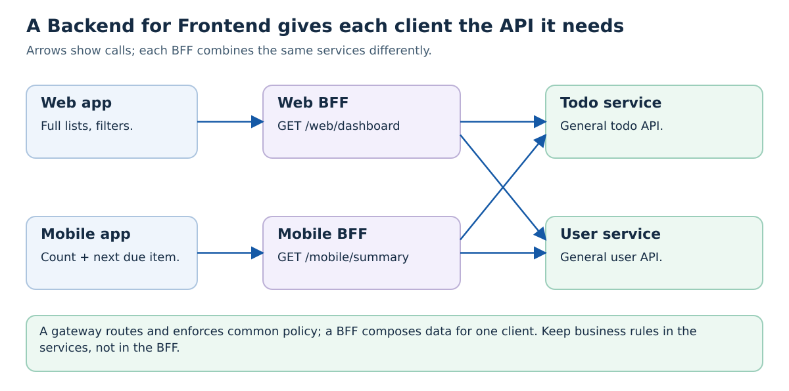

```python
# mobile_bff.py: one response, shaped for the mobile home screen
@app.route('/mobile/summary')
def summary():
    user_id = current_user_id()  # from the verified token (Tutorial 12)
    token = current_verified_access_token()  # trusted middleware supplies it
    response = requests.get(
        f'{TODO_URL}/api/todos', params={'owner': user_id},
        headers={'Authorization': f'Bearer {token}'}, timeout=2,
    )
    response.raise_for_status()
    todos = response.json()
    open_todos = [t for t in todos if not t['done']]
    next_due = min(open_todos, key=lambda t: t.get('due') or '9999-12-31', default=None)
    return jsonify({
        'open_count': len(open_todos),
        'next_due': next_due and {'text': next_due['text'], 'due': next_due.get('due')},
    })
```

This sketch assumes a Todo service that accepts the forwarded token for its configured audience. An `owner` query parameter does not establish permission: the Todo service must validate credentials and enforce ownership itself. A real BFF also maps dependency timeouts and errors into a defined client response.

The BFF contains presentation logic (filtering, sorting, shaping), not the Todo service's business rules. The rule "only the owner may see a todo" stays in the Todo service; otherwise each BFF implements it slightly differently.

A BFF is different from the API gateway in [Tutorial 5](../05-microservices-and-k8s/README.md). A gateway is shared infrastructure that routes requests and applies common policies such as authentication and rate limits. A BFF is application code for one client. Many systems use both: gateway in front, BFFs behind it. With only one web client and one backend, the backend already is the BFF.

> **Solves:** clients with different data needs; chatty clients over slow networks; frontend teams waiting for backend teams to change a general API.
> **You give up:** one more service per client type; duplicated composition code between BFFs.
> **Avoid when:** you have one client, or the clients need nearly identical data.

## 9. Serverless and Functions as a Service

With **Functions as a Service (FaaS)**, a platform invokes application code for a configured trigger such as HTTP, a queue message, an uploaded file, or a timer. The provider manages execution infrastructure; your team still owns the function's behavior, permissions, dependencies, and data. AWS Lambda is [one implementation](https://docs.aws.amazon.com/lambda/latest/dg/welcome.html), not a specification for every serverless platform.

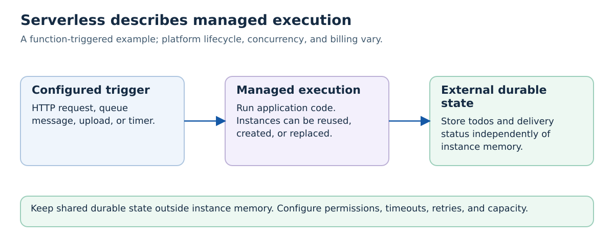

Serverless describes how execution is managed, not where business boundaries belong. One function may handle several routes, and several functions can participate in one application. Managed databases and queues may also be offered as serverless services; their scaling and billing models differ.

```python
# A function that creates a thumbnail when an image is uploaded.
# The event shape is defined by the platform; this is illustrative.
def handle(event, context):
    bucket, key = event['bucket'], event['key']
    image = storage.download(bucket, key)
    storage.upload(bucket, f'thumbnails/{key}', make_thumbnail(image))
```

Compare these properties for the actual platform:

- **Billing and capacity:** Invocation, duration, memory, provisioned capacity, storage, and networking charges can matter. Some configurations scale to zero; minimum capacity or provisioned instances can create idle cost. Use the cost exercise below instead of assuming the cheapest choice.
- **Execution lifecycle:** Instances can be reused, started, or replaced. A new execution environment can add startup latency. Concurrency limits and trigger behavior determine how many instances run; it is not necessarily one new instance per event.
- **State and connections:** Do not use one instance's memory as durable shared todo storage. Reuse clients where supported, but account for database connection limits as concurrency grows. Time limits and support for streaming or long-lived connections vary.
- **Retries:** A queue trigger may retry work after failure, while an HTTP trigger may behave differently. Specify duplicate handling and external effects for the trigger you configure.

The todo API could run on a function platform with external storage. Its HTTP contract could stay the same, while packaging, local debugging, permissions, and operations would change. Kubernetes-based platforms such as Knative offer another execution environment; selecting one does not remove the need to design service boundaries.

> **Solves:** triggered or variable work where managed execution reduces infrastructure work for the team.
> **You give up:** some control over execution and lifecycle; platform-specific limits, integration, and operational practices need investigation.
> **Avoid when:** measured latency, connection, duration, capacity, or portability requirements do not fit the chosen platform.

## 10. Real-Time Push: WebSockets and Server-Sent Events

HTTP is request and response: the browser asks, the server answers. For a shared todo list where Bob should see Alice's change immediately, the UI needs an update mechanism; it can poll or maintain a channel for server **push**. The options are:

- **Polling:** the browser asks every few seconds. Simple, works everywhere, but wastes requests and adds delay.
- **Server-Sent Events (SSE):** the browser opens one long-lived HTTP response with `Content-Type: text/event-stream`, and the server writes events into it. Communication is one-way, server to browser; the browser's `EventSource` reconnects automatically. A good fit for notifications and live updates.
- **WebSockets** ([RFC 6455](https://www.rfc-editor.org/rfc/rfc6455)): an HTTP request is upgraded into a persistent, two-way connection. Useful for chat, collaborative editing, and games with frequent messages in both directions; SSE plus ordinary HTTP requests can also suit some applications.

```javascript
// Browser: receive todo changes pushed by the server over SSE
const events = new EventSource('/api/todos/stream');
events.addEventListener('todo-changed', (event) => {
  const todo = JSON.parse(event.data);
  updateTodoInList(todo);
});
```

The architectural consequence is that connections become **state**. Each open connection lives on one server instance. When Alice's update is handled by server A, Bob, connected to server B, still needs to hear about it. The usual solution is a shared **publish/subscribe channel**, such as Redis Pub/Sub or a message broker: every instance subscribes, and each instance forwards messages to its own connected clients. This is called **fan-out**.

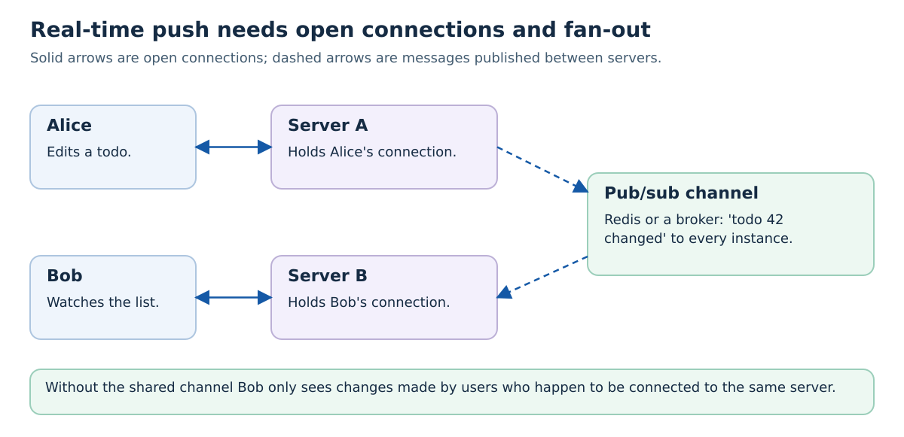

Other consequences to plan for:
- **Load balancers and ingress** must allow long-lived connections and upgrade requests, and their idle timeouts must be longer than your heartbeat interval
- **Sticky sessions** are sometimes needed so that a reconnecting client returns to the same instance, for example with libraries that fall back to polling
- **Capacity** is measured in open connections, not only requests per second; thousands of mostly idle connections use memory and file descriptors
- **Reconnects and missed messages:** a client that reconnects after a network drop has missed events. Send an event ID (SSE supports `Last-Event-ID`) or reload the current state after reconnecting
- **Rolling updates** close every connection on a replaced Pod, so clients must reconnect gracefully

> **Solves:** users who must see changes made by others without reloading; low-latency two-way interaction.
> **You give up:** stateless request handling; simple horizontal scaling; you must manage connections, fan-out, and reconnects.
> **Avoid when:** updates every 30 seconds are acceptable (poll), or the data is only for the user who made the change (the response is enough).

## Other Styles Worth Recognizing

### Service-Based Architecture and SOA

A coarser service-based design might keep todos, teams, and reports in a Workspace service and notifications in a Messaging service. **Service-Oriented Architecture (SOA)** names a broad family of service-oriented integration approaches. It does not uniquely prescribe service size, databases, SOAP, or a central enterprise service bus. Some enterprise implementations use such a bus; it is not a requirement of every service-oriented design. Fowler's [Service Oriented Ambiguity](https://martinfowler.com/bliki/ServiceOrientedAmbiguity.html) explains why the term needs context.

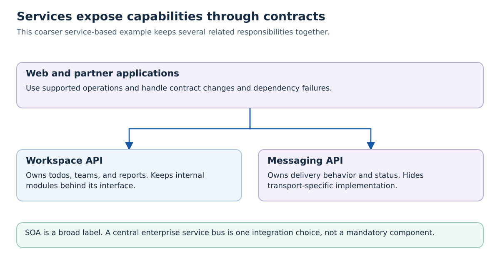

**Solves:** integrating and reusing capabilities across applications. **You give up:** freedom to change contracts without considering callers. **Avoid when:** a network service adds no useful reuse or operational boundary. Compare the actual contracts and ownership rather than deciding from the label alone.

### Pipes and Filters

A **pipeline** divides processing into stages with agreed input and output formats. For an imported todo report, validate records, normalize timestamps, aggregate completion counts, then write the report. Each **filter** implements a stage; a **pipe** carries data to the next one. These can be function calls in one process or separately operated workers. The drawing does not require one server per stage.

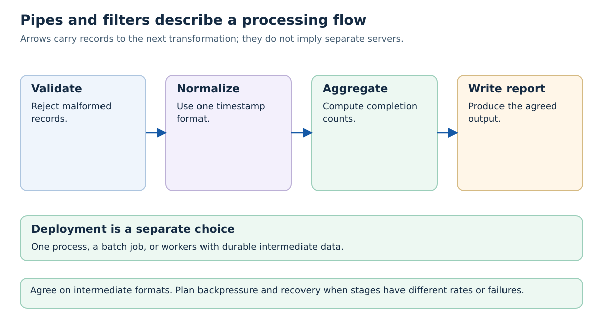

**Solves:** reusable, composable data transformations. **You give up:** intermediate schemas, buffering, checkpointing, and recovery need design. **Avoid when:** splitting a tiny transformation adds no useful composition. If a downstream stage is slower, plan **backpressure** so upstream work does not accumulate indefinitely. See the [Pipes and Filters pattern](https://learn.microsoft.com/azure/architecture/patterns/pipes-and-filters).

### Plug-In or Microkernel Style

A stable application core exposes extension points. A todo-report exporter might call an export interface implemented by CSV and JSON plug-ins. The core decides when to export; each extension translates the report into its own format. A new extension can add behavior without making every core function know every format.

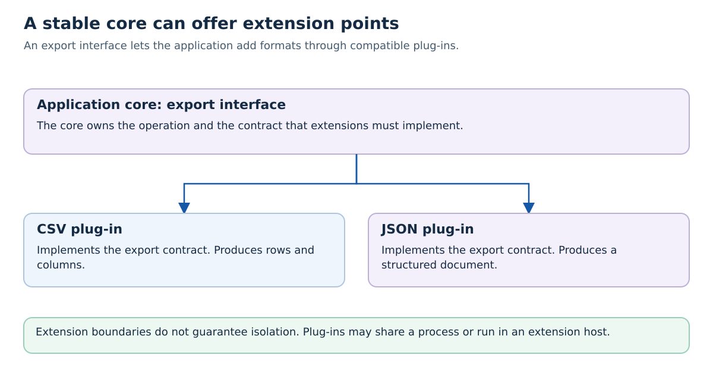

**Solves:** controlled variation around a shared product core. **You give up:** extension compatibility, discovery, permissions, and lifecycle need rules. **Avoid when:** two small helper functions do not need an extension system. A plug-in is not automatically isolated: it can run in the same process or a separate extension host. VS Code documents [several extension-host arrangements](https://code.visualstudio.com/api/advanced-topics/extension-host).

### Microfrontends and Actors

**Microfrontends** divide a frontend into parts that teams can develop and deliver with meaningful independence. Merely splitting a React page into components does not create microfrontends. Composition can happen on the server, at build time, or in the browser, each with different release coupling. Shared dependencies, styling, navigation, and integration add work. See the [micro-frontends article](https://martinfowler.com/articles/micro-frontends.html).

**The actor model** (Carl Hewitt, 1973) structures a program as many small **actors** that each hold private state and communicate only by asynchronous messages, handling one message at a time. Private actor state can reduce shared-memory locking, but calls to shared external resources still need coordination, and actors can be distributed across machines and supervised and restarted when they fail. Actor-oriented ecosystems include Erlang and Elixir, Akka for the JVM, and Microsoft Orleans; their execution and distribution semantics differ. It is worth knowing when you meet systems with very many concurrent, stateful entities, such as chat rooms, game sessions, or devices.

## Comparison

| Style | Boundary it creates | Runtime units | Typical strength | Main cost |
| --- | --- | --- | --- | --- |
| Layered | Technical layers in code | Usually one | Separates HTTP, rules, and storage | Features cut across layers |
| MVC / MVVM / components | UI code structure | Inside one app | Testable, reusable UI | Indirection, implicit updates |
| Modular monolith | Business modules in code | One | Clear ownership without network cost | Single release and scaling unit |
| Hexagonal / Clean | Core vs adapters | Inside one app | Fast tests, replaceable tools | More interfaces and mapping |
| Microservices | Business services over the network | Many | Independent release and scaling | Distributed failures and data |
| Event-driven | Producers vs consumers through events | One or many | Loose coupling, buffering | Eventual consistency, duplicates |
| CQRS | Different write and read models | One or many | Specialized operation and query models | Keeping models consistent |
| Event sourcing | Event history as canonical state | One or many | Replay and historical reconstruction | History evolution and retention |
| SOA / service-based | Capability contracts | Several services | Integration and reuse | Contract and ownership coordination |
| Pipes and filters | Processing-stage contracts | One or many | Reusable transformations | Formats, buffering, recovery |
| Plug-in | Core vs extension interface | Platform-dependent | Controlled product variation | Compatibility and extension lifecycle |
| BFF | One backend per client type | One per client | Client-shaped APIs | More services, duplication |
| Serverless | Platform-managed execution | Platform-dependent | Managed capacity and lifecycle | Startup behavior, limits, dependencies |
| Real-time push | Open connections | Many instances plus pub/sub | Instant updates | Connection state and fan-out |

Notice that the rows are not alternatives to each other. Some rows structure code inside a deployable unit, while others describe data, communication, delivery, or execution. The runtime-unit counts are examples, not required deployment shapes. A real system **combines** them. A typical course project could be: a React frontend with components, a gateway, a modular backend whose modules are internally layered, PostgreSQL, and one background worker consuming events from RabbitMQ. Each of those choices should answer a requirement you can name.

## Evolve, Don't Pick Up Front

Early in a project you know least about where the boundaries should be. Splitting into services at that point fixes guesses into network contracts that are expensive to change. Fowler's [MonolithFirst](https://martinfowler.com/bliki/MonolithFirst.html) describes the common observation that successful microservice systems usually started as monoliths that were split later.

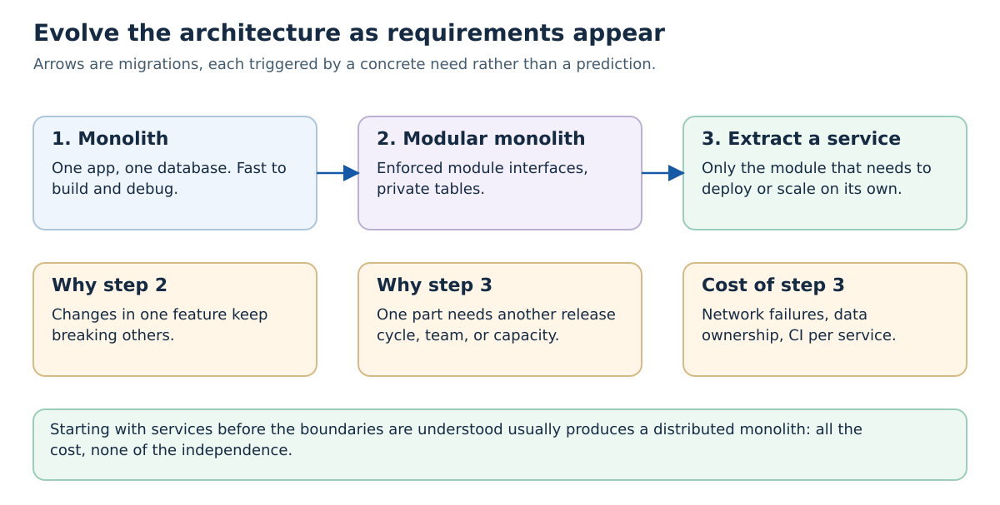

A practical path:

1. **Monolith.** One Flask app, one database, layered internally. Get the features working and learn what the domain really is.
2. **Modular monolith.** When changes in one area keep breaking others, introduce business modules with public interfaces and private tables, and enforce the rules with a test or linter.
3. **Extract one service.** When one module has a concrete reason to be independent, such as a different release pace, a separate team, heavy load, or a different technology, move that one module behind an HTTP or message API. Its public interface becomes the contract. Often the first step is the **strangler fig pattern**: put a proxy in front, route the extracted endpoints to the new service, and keep the rest in the monolith.

Each step should be justified by evidence: deployment logs showing release conflicts, profiling showing one module's load, or a team split. "We might need to scale" is a prediction, not evidence. The reverse move also happens: teams merge services that always change together back into one.

In this course, the project requirement is a microservice system on Kubernetes, because operating several services is part of what you are learning. Apply the same reasoning to your service boundaries: each service should own a responsibility and its data, and you should be able to explain why it is separate.

## Record a Decision and Its Failure Behavior

Before adding infrastructure, write a short **architecture decision record** for the todo app:

```text
Requirement: What concrete change or failure must the system support?
Context: Team size, traffic, data, and operational constraints.
Alternatives: At least two designs that meet the requirement.
Decision: Chosen boundaries, data owners, and interaction contracts.
Consequences: Added work and deliberately accepted limitations.
Evidence: What would make us revisit this choice?
```

Then trace one operation through its failure points:

| Failure | Decision the design needs |
| --- | --- |
| A downstream service is unavailable | Fail the operation or durably defer the dependent work? |
| A write succeeds but its response is lost | How can a retry avoid creating a second todo? |
| An event is delivered twice | What identifies duplicate work and prevents duplicate effects? |
| An instance restarts | Which state survives, and where does it live? |
| An old consumer receives a new event version | Which compatibility or migration rule applies? |

An **outbox** can couple a database change with a record of work to publish. A **saga** coordinates a multi-step business operation using retries and compensating actions. Compensation is a new business action, not a literal rollback of an email already sent. These are advanced solutions for specific failure requirements, not prerequisites for every application.

## Exercises

1. **Predict, then trace a feature.** Add "due date" to the todo app. For the layered, modular monolith, hexagonal, and microservice versions, predict which files, services, and databases change and which deployments are needed. Which version needs coordinated releases?
2. **Find the boundary violations.** In the modular monolith layout from section 3, suppose `notifications` runs `SELECT * FROM todos` to find due todos. Explain what breaks when the todos module renames a column. Propose the public function that should replace the query, and a test that would catch the violation.
3. **Write a port.** For the hexagonal example, add a `Notifier` port used when a todo is completed. Write the in-memory adapter for tests and describe the real adapter. Which test now runs without any network?
4. **Notification or state transfer?** A Stats service shows "todos completed today". Decide whether `TodoCompleted` should carry only the ID or the full todo. What happens in each design if the Todo service is down for ten minutes? What if the same event is delivered twice?
5. **Design a BFF response.** Sketch the JSON a mobile home screen needs and the calls the BFF makes to produce it. Which rule must not move into the BFF, and why?
6. **Serverless cost estimate.** Using any provider's public price list, estimate the monthly cost of the todo API as functions at 1,000 requests per day and at 50 requests per second continuously. Compare with one small always-on VM or container. Where is the crossover, and which assumptions matter most?
7. **Real-time failure.** Two replicas serve SSE connections without a shared pub/sub channel. Predict what Bob sees when Alice edits a todo. Then predict what happens during a rolling update. What would you log to confirm each prediction?
8. **Conway check for your project.** List your project's planned services and the person or sub-group who will own each one. Where does one owner have several services that always change together? Would merging them lose anything?

For each exercise, write down your prediction before reasoning it through, as described in the course [README](../README.md#how-to-work-through-a-tutorial).

## Common Mistakes

- **Choosing by popularity.** "Netflix uses microservices" describes Netflix's teams, traffic, and operations budget, not your project.
- **Distributed monolith.** Services that share a database, or must always be released together, combine the cost of both styles.
- **Pattern stacking.** Adding hexagonal ports, CQRS, and event sourcing to a CRUD application with no rules. Every pattern should answer a requirement.
- **Boundaries by technical layer across services.** A "database service" and a "logic service" force every feature through every service. Split services by business responsibility.
- **Ignoring failure.** Drawing arrows between services without deciding timeouts, retries, and what the user sees when a call fails.
- **Rules in the edge.** The same business rule independently copied into several clients or adapters instead of living in one owning component. A serverless function can itself host that owning component.

## Next Steps

Continue with [Tutorial 5: Microservices and Kubernetes](../05-microservices-and-k8s/README.md), which takes one of these styles, microservices, and shows how to define service boundaries and run the services on Kubernetes. The event-driven ideas return in [Tutorial 14: Service Communication](../advanced/14-service-communication/README.md), and the testing benefits of hexagonal design in [Tutorial 10](../10-testing-ci/README.md).

## Further Reading

- Melvin Conway, [How Do Committees Invent?](https://www.melconway.com/Home/Committees_Paper.html) (1968)
- [The Twelve-Factor App](https://12factor.net/)
- Alistair Cockburn, [Hexagonal Architecture](https://alistair.cockburn.us/hexagonal-architecture/)
- Martin Fowler, [What do you mean by "Event-Driven"?](https://martinfowler.com/articles/201701-event-driven.html), [CQRS](https://martinfowler.com/bliki/CQRS.html), [Event Sourcing](https://martinfowler.com/eaaDev/EventSourcing.html), [MonolithFirst](https://martinfowler.com/bliki/MonolithFirst.html), [Strangler Fig Application](https://martinfowler.com/bliki/StranglerFigApplication.html)
- James Lewis and Martin Fowler, [Microservices](https://martinfowler.com/articles/microservices.html)
- Sam Newman, [Backends for Frontends](https://samnewman.io/patterns/architectural/bff/), and the book *Building Microservices* (2nd ed., O'Reilly, 2021)
- Cam Jackson, [Micro Frontends](https://martinfowler.com/articles/micro-frontends.html)
- MDN, [Server-sent events](https://developer.mozilla.org/en-US/docs/Web/API/Server-sent_events) and [The WebSocket API](https://developer.mozilla.org/en-US/docs/Web/API/WebSockets_API)
- Mark Richards and Neal Ford, *Fundamentals of Software Architecture* (O'Reilly, 2020)
