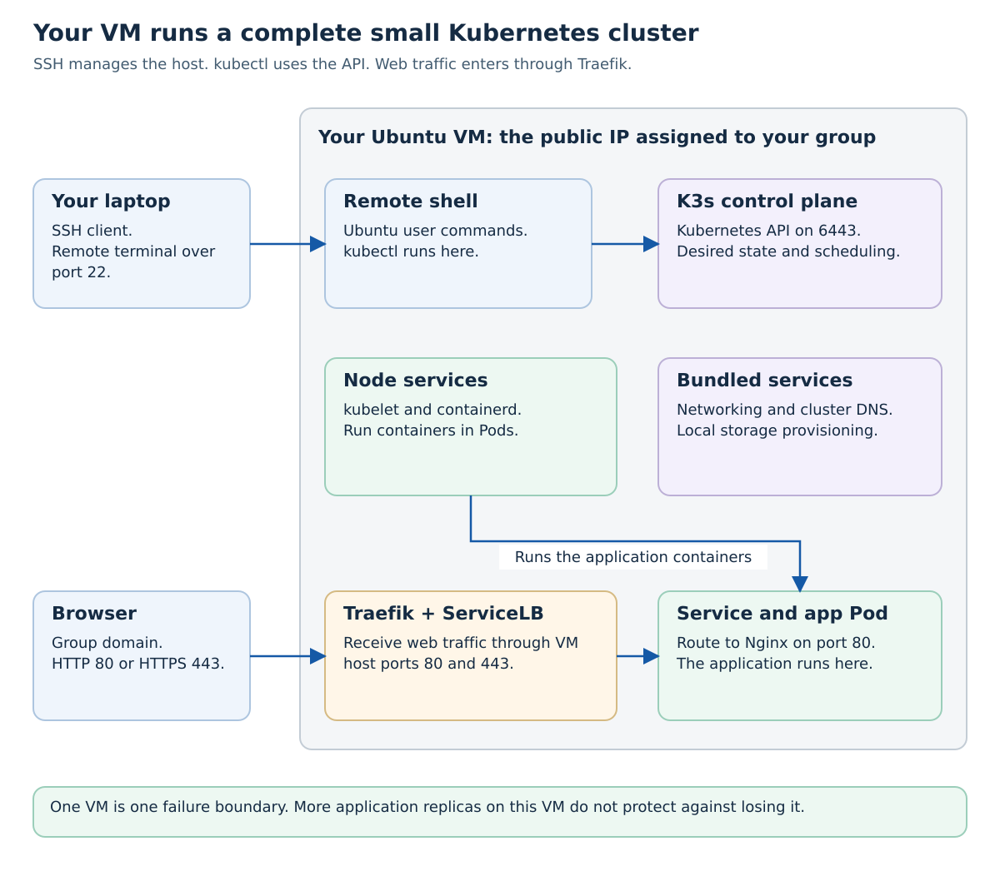
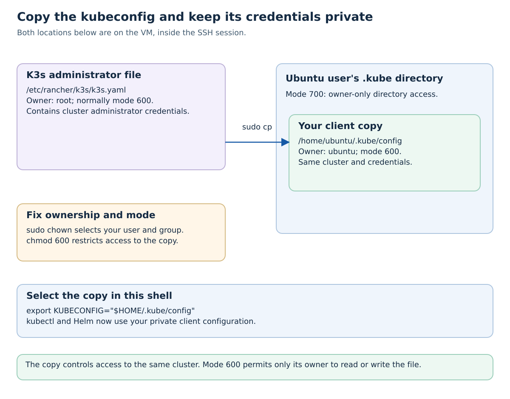
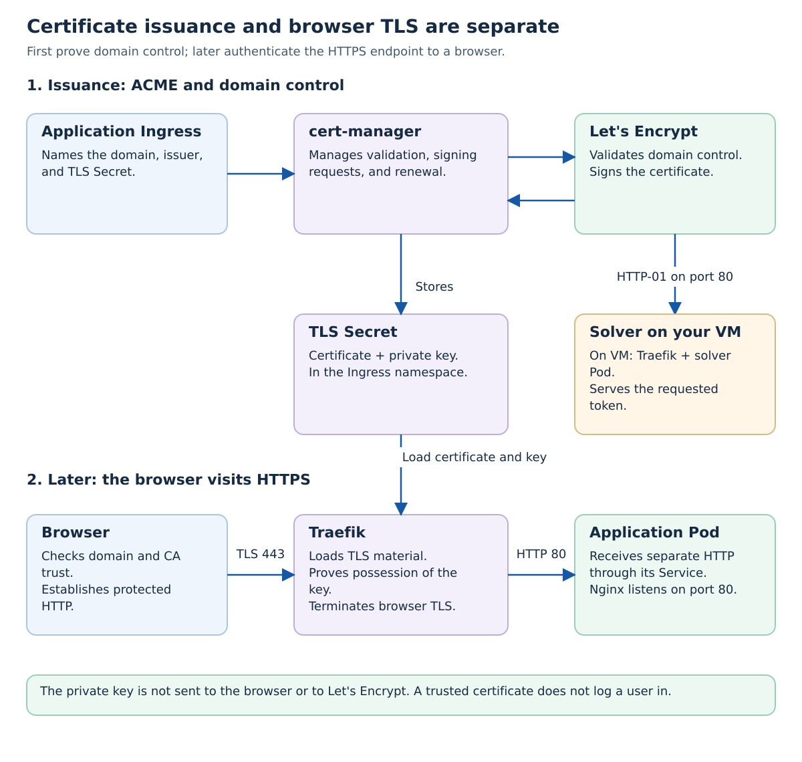

# Tutorial 5B: Set Up K3s on Your VM and Enable HTTPS

Your group receives an Ubuntu virtual machine (VM), its public IP address, and a domain such as `group-XX-m7011e-ltu.se`. You will log in, install Kubernetes using K3s, configure kubectl, and obtain a trusted HTTPS certificate using cert-manager and Let's Encrypt.

Read [Tutorial 5](../05-microservices-and-k8s/README.md) first. This tutorial builds the cluster that later tutorials use; it does not assume someone has already installed an ingress controller or certificate manager for you. Follow the steps on your group's assigned VM only.

**Course checkpoint — Friday 13 November 2026:** prepare the environment in sections 1–15 and use the [mandatory environment demonstration brief](./DEMONSTRATION.md) to prepare for Casper's session. Keep the sample application available until you have demonstrated it; the cleanup in section 16 can wait. If you have already replaced it with a later tutorial's application, demonstrate that equivalent working setup using its actual resource names.

## Learning Objectives

- Explain SSH, K3s, kubectl, an ingress controller, and cert-manager as separate parts of the system.
- Install a single-node Kubernetes cluster and give your Ubuntu user a private kubeconfig copy.
- Explain what a certificate proves, what the private key does, and where TLS terminates.
- Trace domain validation separately from a browser's HTTPS connection.
- Test issuance with Let's Encrypt staging, then obtain a production certificate.
- Diagnose failures by inspecting DNS, workloads, issuers, requests, challenges, and logs.

## 1. What Is K3s?

Kubernetes is a system for declaring and running container workloads. A **Kubernetes distribution** packages Kubernetes components with installation and operational choices. **K3s** is a lightweight, conformant Kubernetes distribution: you still use standard resources such as Pods, Deployments, Services, and Ingresses. It is not a smaller replacement API that requires a different application format.

K3s reduces the setup work by packaging the control plane and commonly needed supporting components. A default single-server installation includes a container runtime, networking, DNS, storage provisioning, and an ingress controller. See the [K3s overview](https://docs.k3s.io/) for its packaging choices.



| Part | Its job in this tutorial |
| --- | --- |
| Ubuntu VM | The machine you administer; its public IP makes it reachable. |
| K3s server | Runs the Kubernetes control plane and, here, the worker role on the same VM. |
| Kubernetes API | Accepts kubectl requests and stores desired resource state. |
| containerd | Runs containers for Kubernetes. Installing Docker on the VM is not required for this K3s setup. |
| CoreDNS and networking | Let Pods find and communicate with services inside the cluster. |
| Local-path storage provisioner | Can provide local persistent volumes for later database exercises. Local disk is not a backup. |
| Traefik and ServiceLB | Provide the default ingress path on ports 80 and 443. |
| cert-manager | An additional component you install to obtain and renew certificates. It is not included by this K3s installation. |

**Why use it here?** Installing each control-plane component separately would hide the web-system exercises behind a larger administration task. K3s gives the group a small cluster whose behavior it can inspect. Other distributions and managed Kubernetes services make different choices about installation, upgrades, networking, storage, and who operates the control plane.

One VM is also one failure boundary: its workloads and control plane share CPU, memory, and disk. Several replicas on that VM do not survive losing the VM. Revisit [Tutorial 5's controllers and scaling](../05-microservices-and-k8s/README.md) when comparing this lab with a multi-node system.

## 2. Prerequisites and Where Commands Run

Have the VM's assigned IP, domain, SSH authentication instructions, and permission to use `sudo`. K3s's documented server minimum is two CPU cores and 2 GB RAM, before adding application workloads; inspect the resources supplied for the course rather than assuming every later stack will fit. See the [K3s requirements](https://docs.k3s.io/installation/requirements).

| Location | Commands run there |
| --- | --- |
| Your laptop | The initial SSH command and the final public DNS/HTTPS checks. |
| The Ubuntu VM, inside SSH | Package installation, K3s, kubeconfig setup, and all kubectl commands in this tutorial. |

The examples use documentation IP `203.0.113.10` and example group `07`. **Replace them with your assigned values.** Do not add `www`, `test`, or another subdomain unless DNS has also been configured for it.

| Inbound TCP port | Purpose | Who needs access |
| --- | --- | --- |
| 22 | SSH administration | Your group through the course's allowed network rules. |
| 80 | HTTP and the ACME HTTP-01 challenge | The public internet, including Let's Encrypt. |
| 443 | HTTPS application traffic | Your application's users. |
| 6443 | Kubernetes API | Local kubectl on the VM in this walkthrough; public access is unnecessary. |

Check the VM provider's firewall rules as well as any firewall inside Ubuntu. Installing an Ingress does not open a provider firewall or create a DNS record.

## 3. Log In with SSH

**On your laptop:**

```bash
VM_IP='203.0.113.10'
ssh "ubuntu@$VM_IP"
```

`VM_IP=...` stores the address in this shell. `ssh` starts **Secure Shell**, an encrypted connection to a remote computer. `ubuntu` is the remote account and the text after `@` identifies the host: the command has the form `ssh ubuntu@XXX.XXX.XXX.XXX`. SSH normally uses port 22. It protects terminal input and output; it does not install Kubernetes or give a web application HTTPS.

On a first connection, SSH shows the server's host-key fingerprint. Compare it with the course's trusted VM information before accepting it. Authenticate using the key or password supplied for your VM. If a specific private-key file is required, use `ssh -i /path/to/key "ubuntu@$VM_IP"`; `-i` selects that identity file.

**Now on the VM:**

```bash
whoami
hostname
pwd
```

`whoami` prints the remote account, `hostname` identifies the remote machine, and `pwd` prints its working directory. Expect the Ubuntu account on your group's VM, not your laptop. Leaving SSH with `exit` returns to the laptop; it does not stop programs running as VM services.

**Predict:** If you create a file now, which computer stores it? Why would running `sudo` in this session affect the VM rather than your laptop?

## 4. Prepare the VM and Check DNS

Run the rest of the installation steps **on the VM**:

```bash
sudo apt-get update
sudo apt-get install -y curl ca-certificates dnsutils openssl less
```

`sudo` runs the following command with administrator privileges. `apt-get update` refreshes the package index; it does not upgrade all installed packages. `install` installs the named tools, and `-y` accepts package-manager prompts. `curl` makes HTTP requests, `ca-certificates` supplies trusted CA roots, `dnsutils` provides `dig`, and `openssl` inspects certificates and TLS.

Set the values again inside SSH: laptop shell variables are not automatically copied to the remote shell. Replace the email with the contact specified for your group; the address shown is the course example, not an instruction to invent an email address.

```bash
export DOMAIN='group-07-m7011e-ltu.se'
export VM_IP='203.0.113.10'
export ACME_EMAIL='johan.kristiansson@ltu.se'
dig +short A "$DOMAIN"
dig +short AAAA "$DOMAIN"
```

`export` makes the variables available to programs started from this shell. Quoting `"$DOMAIN"` passes its value as one argument. `dig` queries DNS; `+short` prints the answers without the longer diagnostic report. The A record must reach your VM's public IPv4 address. If an AAAA record exists, its IPv6 route must also work; an incorrect IPv6 record can break validation even when IPv4 works, as [Let's Encrypt explains](https://letsencrypt.org/docs/ipv6-support/). Do not request a certificate until DNS points to the intended VM.

### If Ubuntu's Firewall Is Active

```bash
sudo ufw status verbose
```

This reads the guest firewall status. If UFW is installed and active, the following rules allow the course traffic and K3s's default internal networks:

```bash
sudo ufw allow 22/tcp
sudo ufw allow 80/tcp
sudo ufw allow 443/tcp
sudo ufw allow in on lo to any port 6443 proto tcp
sudo ufw allow from 10.42.0.0/16 to any
sudo ufw allow from 10.43.0.0/16 to any
```

`allow` adds a rule; `tcp` selects the transport protocol. `lo` is the VM's loopback interface, so that API rule does not open port 6443 to the internet. The two address ranges are K3s's default Pod and Service networks, not your public IP range. Use the corresponding configured ranges if the course changes them. Follow the [K3s firewall requirements](https://docs.k3s.io/installation/requirements#operating-systems) and the course's provider firewall settings if packets are still blocked. These commands do not enable UFW when it is inactive, and they do not change the provider's firewall.

## 5. Install K3s

This walkthrough pins **[K3s `v1.36.5+k3s1`](https://github.com/k3s-io/k3s/releases/tag/v1.36.5%2Bk3s1)** and **[cert-manager `v1.21.3`](https://github.com/cert-manager/cert-manager/releases/tag/v1.21.3)**. The version pair was checked in October 2026 against cert-manager's [Kubernetes compatibility table](https://cert-manager.io/docs/releases/). Version pins make the exercise reproducible; check supported releases when maintaining the course rather than combining an arbitrary newest Kubernetes with an old cert-manager manifest.

```bash
curl --fail --show-error --location https://get.k3s.io -o install-k3s.sh
less install-k3s.sh
```

`curl` downloads the official installer to a local file. `--fail` reports unsuccessful HTTP responses, `--show-error` shows transfer errors, `--location` follows redirects, and `-o` names the output file. `less` lets you inspect that script before running it; press `q` to leave the viewer. Downloading the script alone does not install anything.

```bash
sudo env INSTALL_K3S_VERSION='v1.36.5+k3s1' sh ./install-k3s.sh server
sudo systemctl status k3s --no-pager
```

`env` supplies the pinned version to the installer. `sh` executes the downloaded script; `server` selects the K3s server role. The installer downloads K3s and creates and starts its system service, including the worker role and bundled runtime. The service continues after you close SSH. `systemctl status` reads the service state, and `--no-pager` prints it directly. Look for an active service. See the [official installation workflow](https://docs.k3s.io/quick-start) and [installer options](https://docs.k3s.io/reference/env-variables).

## 6. Copy the Kubeconfig with Correct Permissions

K3s writes its administrator kubeconfig to **`/etc/rancher/k3s/k3s.yaml`**. This is the standard K3s filesystem path. The file contains credentials that can administer the cluster, so the original is normally readable by root.

On this fresh course VM, copy it to the Ubuntu user's client configuration:

```bash
mkdir -p "$HOME/.kube"
chmod 700 "$HOME/.kube"
sudo cp /etc/rancher/k3s/k3s.yaml "$HOME/.kube/config"
sudo chown "$(id -u):$(id -g)" "$HOME/.kube/config"
chmod 600 "$HOME/.kube/config"
export KUBECONFIG="$HOME/.kube/config"
```

The copy command replaces `~/.kube/config`; preserve an existing configuration first if this VM is not fresh. Here `~` and `$HOME` refer to **the remote Ubuntu user's home**, normally `/home/ubuntu`.

| Command | What it changes and why |
| --- | --- |
| `mkdir -p` | Creates the directory if needed, including when it already exists. |
| `chmod 700` | Gives only the directory owner read, write, and traversal access. |
| `sudo cp` | Reads the root-owned source and creates your local client copy. It does not create a second cluster. |
| `sudo chown ...` | Makes your user and primary group own the copied file. `$(id -u)` and `$(id -g)` substitute the current user's numeric IDs before sudo runs. |
| `chmod 600` | Gives only the file owner read/write access; other local users cannot read the credentials. |
| `export KUBECONFIG=...` | Selects this copy for kubectl and Helm in the current shell. This also overrides the bundled K3s kubectl's default root-owned path. |



```bash
stat -c '%a %U:%G %n' "$HOME/.kube" "$KUBECONFIG"
kubectl config current-context
kubectl get nodes -o wide
```

`stat` prints numeric permissions, owner/group, and path. Expect `700 ubuntu:ubuntu` for the directory and `600 ubuntu:ubuntu` for the file. `current-context` reads the selected local context. `get nodes` contacts the API, and `-o wide` adds details such as node addresses. Wait for your node to become `Ready`.

The API address `https://127.0.0.1:6443` works because kubectl runs **on the VM**. In a laptop configuration, that address would mean the laptop instead. [Tutorial 6](../06-k8s-getting-started/README.md) explains optional laptop access through an SSH tunnel. Do not publish this kubeconfig or make the source file world-readable.

Run `export KUBECONFIG="$HOME/.kube/config"` again in a new SSH session, or configure your shell profile. K3s refreshes its original administrator configuration as it manages certificates; if the copied credentials later expire, refresh the copy and its permissions. See [K3s cluster access](https://docs.k3s.io/cluster-access).

## 7. Verify the Bundled Cluster Components

```bash
kubectl get pods -A
kubectl rollout status deployment/traefik -n kube-system --timeout=300s
kubectl get ingressclass
kubectl get service traefik -n kube-system
kubectl get storageclass
```

`get pods -A` lists Pods across all namespaces. `rollout status` waits for Traefik's Deployment to finish becoming available, with a five-minute limit. The remaining commands inspect the ingress class, Traefik's Service, and storage classes. Expect the `traefik` class, a Traefik Service exposing 80/443, and the default local-path storage class. If a resource does not exist yet, inspect the `kube-system` Pods before retrying.

K3s deploys Traefik and uses ServiceLB to expose its Service through the VM's host ports 80/443; a provider may still show the VM's private address in Kubernetes status. These are not the usual high-numbered Kubernetes NodePorts. The public domain must reach the VM through its actual public routing. Do not install a second ingress controller for this exercise. See [K3s networking services](https://docs.k3s.io/networking/networking-services).

**Checkpoint:** Explain the difference between an active K3s service, a Ready node, and a ready Traefik Deployment. Which check proves that the public domain can already serve your application? None yet: no application route has been created.

## 8. Certificates, TLS, Let's Encrypt, and cert-manager

**HTTP** carries requests and responses. **TLS** protects a connection and normally authenticates the server for the requested hostname. **HTTPS** is HTTP carried over that protected connection. The phrase “SSL certificate” persists, but modern HTTPS uses TLS. SSH also encrypts a connection, but an SSH login does not configure a browser-facing TLS endpoint.

A **certificate** is a signed statement binding names, such as your group's domain, to a public key. It also has an issuer and validity interval. The server must hold the matching **private key** and prove that during the TLS handshake; the private key is not sent to the browser. The browser checks the name, validity, and chain to a trusted certificate authority (CA). The handshake establishes traffic keys used to protect subsequent HTTP messages. A valid certificate does not prove that a site's content or business is trustworthy.

**Let's Encrypt** is a CA. Its **ACME** protocol automates domain-control validation and issuance. **cert-manager** is the Kubernetes controller that carries out that workflow and renews certificates. A **ClusterIssuer** names the ACME service and validation method; a **Certificate** requests particular names; a **Secret** stores the resulting certificate and private key for the ingress controller.

The name Secret does not itself mean encrypted storage. Access to these objects must be restricted; a cluster administrator can read their contents. Inspect the public certificate and status without publishing the private key.



For **HTTP-01**, Let's Encrypt requests a token at `http://YOUR_DOMAIN/.well-known/acme-challenge/TOKEN` on port 80. cert-manager creates a temporary solver Pod, Service, and Ingress to answer it. An arbitrary path ending in `/test` is not a valid challenge token. The process proves domain control, not the identity of an application user. See [Let's Encrypt's challenge explanation](https://letsencrypt.org/docs/challenge-types/).

After issuance, Traefik loads the certificate/key from a Secret and terminates browser TLS on port 443. It makes a separate HTTP connection to our Nginx Service. The TLS configuration here does not automatically encrypt every internal Pod connection. [Tutorial 7](../07-k8s-helloworld/README.md#before-deploying-how-https-reaches-your-application) follows that request path in more detail, and [Tutorial 12](../12-keycloak/README.md) later adds login and API authorization.

## 9. Install cert-manager

### Install Its API Extensions and Controllers

```bash
kubectl apply -f https://github.com/cert-manager/cert-manager/releases/download/v1.21.3/cert-manager.yaml
kubectl rollout status deployment/cert-manager -n cert-manager --timeout=300s
kubectl rollout status deployment/cert-manager-cainjector -n cert-manager --timeout=300s
kubectl rollout status deployment/cert-manager-webhook -n cert-manager --timeout=300s
```

`apply -f URL` reads the official release manifest and creates or updates its declared resources. It includes **CustomResourceDefinitions (CRDs)**, which add Certificate and issuer resource types to the API, plus the controllers and their permissions. Each `rollout status` waits for one Deployment to become available; requesting installation and observing readiness are separate steps. This is the [upstream kubectl installation method](https://cert-manager.io/docs/installation/kubectl/).

```bash
kubectl get pods -n cert-manager
kubectl get crd certificates.cert-manager.io clusterissuers.cert-manager.io challenges.acme.cert-manager.io
```

The first command should show running Pods for `cert-manager`, `cert-manager-cainjector`, and `cert-manager-webhook`. The second checks specific API definitions; CRDs existing does not by itself prove the webhook is ready. If an immediate issuer creation reports a webhook startup error, inspect the webhook logs and retry after it becomes available.

## 10. Create Staging and Production ClusterIssuers

Start with **staging**. It tests the complete issuance flow using certificates that normal browsers **do not trust**. It has separate, more generous testing limits. Production is for the later browser-trusted certificate. See [Let's Encrypt staging](https://letsencrypt.org/docs/staging-environment/).

### Staging

```bash
cat <<EOF | kubectl apply -f -
apiVersion: cert-manager.io/v1
kind: ClusterIssuer
metadata:
  name: letsencrypt-staging
spec:
  acme:
    server: https://acme-staging-v02.api.letsencrypt.org/directory
    email: ${ACME_EMAIL}
    privateKeySecretRef:
      name: letsencrypt-staging-account-key
    solvers:
    - http01:
        ingress:
          ingressClassName: traefik
EOF
```

`cat <<EOF` emits the lines up to `EOF`; this is a shell **here-document**. Its unquoted delimiter allows `${ACME_EMAIL}` to become your variable's value. `|` pipes that text to kubectl, and the final `-` in `-f -` means “read the manifest from standard input.” The YAML declares an object; it is not a sequence of shell commands.

`server` selects the staging ACME endpoint. `email` is the account contact. `privateKeySecretRef` names the **ACME account key**, which differs from an application's TLS private key. `ingressClassName: traefik` tells cert-manager which controller should handle the HTTP-01 solver route. This field is the [recommended HTTP-01 configuration](https://cert-manager.io/docs/configuration/acme/http01/#ingressclassname).

### Production

```bash
cat <<EOF | kubectl apply -f -
apiVersion: cert-manager.io/v1
kind: ClusterIssuer
metadata:
  name: letsencrypt-prod
spec:
  acme:
    server: https://acme-v02.api.letsencrypt.org/directory
    email: ${ACME_EMAIL}
    privateKeySecretRef:
      name: letsencrypt-prod-account-key
    solvers:
    - http01:
        ingress:
          ingressClassName: traefik
EOF
kubectl wait --for=condition=Ready clusterissuer/letsencrypt-staging --timeout=180s
kubectl wait --for=condition=Ready clusterissuer/letsencrypt-prod --timeout=180s
kubectl get clusterissuers
```

This creates a separate ACME account configuration for production. `wait` observes the named resource's Ready condition within the time limit; `get` displays both issuers. A Ready issuer means the account configuration is ready, not that your domain has already been validated or any application certificate exists.

If readiness fails, use `kubectl describe clusterissuer letsencrypt-staging` or `kubectl describe clusterissuer letsencrypt-prod`. `describe` includes conditions and events that explain account registration or configuration errors.

## 11. Deploy a Small Test Application

Keep every application resource in **`tls-demo`**. The issuer is cluster-scoped; Deployments, ConfigMaps, Services, Ingresses, Certificates, and TLS Secrets are namespace-scoped.

```bash
kubectl create namespace tls-demo
```

This creates only the namespace. On a repeat run, `AlreadyExists` means it is already present; inspect it with `kubectl get namespace tls-demo` rather than deleting it to repeat the exercise.

```bash
cat <<EOF | kubectl apply -n tls-demo -f -
apiVersion: v1
kind: ConfigMap
metadata:
  name: hello-html
  namespace: tls-demo
data:
  index.html: |
    <!DOCTYPE html>
    <html lang="en">
    <head><title>K3s HTTPS test</title></head>
    <body>
      <h1>Hello from the course VM</h1>
      <p>Domain: ${DOMAIN}</p>
      <p>The browser's certificate check, not this text, proves TLS trust.</p>
    </body>
    </html>
---
apiVersion: apps/v1
kind: Deployment
metadata:
  name: hello-world
  namespace: tls-demo
spec:
  replicas: 1
  selector:
    matchLabels:
      app: hello-world
  template:
    metadata:
      labels:
        app: hello-world
    spec:
      containers:
      - name: nginx
        image: nginx:alpine
        ports:
        - containerPort: 80
        volumeMounts:
        - name: html
          mountPath: /usr/share/nginx/html
          readOnly: true
      volumes:
      - name: html
        configMap:
          name: hello-html
---
apiVersion: v1
kind: Service
metadata:
  name: hello-world
  namespace: tls-demo
spec:
  selector:
    app: hello-world
  ports:
  - port: 80
    targetPort: 80
EOF
kubectl rollout status deployment/hello-world -n tls-demo --timeout=180s
kubectl get pods,services -n tls-demo
```

The ConfigMap supplies the HTML file, the Deployment asks for one Nginx Pod, and the Service selects Pods labelled `app: hello-world`. `volumeMounts` makes the ConfigMap visible at Nginx's document directory; `containerPort` describes the container's port but does not expose it publicly. The Service's `port` is its client-facing port, and `targetPort` identifies the destination port in the selected Pod.

The `-n tls-demo` command option and every `metadata.namespace` agree. Using `-n test` while declaring `namespace: default` would not move these resources into `test`; inconsistent namespace declarations are errors, not a way to redirect them.

### Add the Staging Ingress

```bash
cat <<EOF | kubectl apply -n tls-demo -f -
apiVersion: networking.k8s.io/v1
kind: Ingress
metadata:
  name: hello-world
  namespace: tls-demo
  annotations:
    cert-manager.io/cluster-issuer: letsencrypt-staging
spec:
  ingressClassName: traefik
  tls:
  - hosts:
    - ${DOMAIN}
    secretName: hello-world-staging-tls
  rules:
  - host: ${DOMAIN}
    http:
      paths:
      - path: /
        pathType: Prefix
        backend:
          service:
            name: hello-world
            port:
              number: 80
EOF
kubectl get ingress hello-world -n tls-demo
curl --head "http://$DOMAIN"
```

The Ingress matches the HTTP hostname and `/` path, then routes through the Service. `tls.hosts` names the certificate's hostname, and `secretName` names the TLS material Traefik will use. The annotation asks cert-manager's ingress-shim to create a Certificate in the **same namespace**. It does not install an issuer or create DNS. `curl --head` requests HTTP response headers; a successful plain HTTP response still says nothing about certificate trust.

## 12. Observe Issuance and Test Staging

```bash
kubectl get certificates -n tls-demo --watch
```

`--watch` keeps printing changes. Wait for `hello-world-staging-tls` to appear; press **Ctrl+C** to stop watching, not to delete the resource. Creation is asynchronous, so a wait command for that name can report NotFound if you run it before the Certificate exists.

```bash
kubectl wait --for=condition=Ready certificate/hello-world-staging-tls -n tls-demo --timeout=300s
kubectl describe certificate hello-world-staging-tls -n tls-demo
kubectl get certificaterequests,orders,challenges -n tls-demo
kubectl get secret hello-world-staging-tls -n tls-demo
```

The Certificate describes the desired result; a CertificateRequest carries a signing request; ACME Orders and Challenges track validation. `get secret` checks that the result exists without printing its private key. Temporary challenge objects may disappear after successful issuance; an empty challenge list afterward is normal.

To investigate while a challenge is active:

```bash
kubectl get challenges -A
kubectl describe challenges -n tls-demo
kubectl logs deployment/cert-manager -n cert-manager --tail=50
kubectl logs deployment/cert-manager-webhook -n cert-manager --tail=20
kubectl logs deployment/cert-manager-cainjector -n cert-manager --tail=20
```

`-A` lists all namespaces. `describe` shows challenge state and events. `logs deployment/NAME` selects logs from that component's Deployment; `--tail` limits the initial output. Add `--follow` to stream future log lines, then use Ctrl+C to stop following. The controller coordinates issuance, the webhook validates API requests, and cainjector distributes CA trust data to Kubernetes API integrations.

Test the staging endpoint:

```bash
curl --head "https://$DOMAIN"
curl --insecure --head "https://$DOMAIN"
```

The first call is expected to reject a staging certificate's trust chain. The second is a deliberate **staging-only diagnostic**: `--insecure` bypasses certificate verification for that one curl call so you can inspect application routing. Do not carry it into production checks. A Ready staging Certificate and an untrusted browser warning are compatible results.

**Explain:** How can encrypted traffic work while normal certificate verification fails? What would a successful staging issuance tell you about DNS and HTTP-01, and what would it not tell you about application authorization?

## 13. Switch to a Production Certificate

After staging succeeds, update the issuer and use a **different Secret name** in one patch:

```bash
kubectl patch ingress hello-world -n tls-demo --type=merge --patch-file=/dev/stdin <<EOF
metadata:
  annotations:
    cert-manager.io/cluster-issuer: letsencrypt-prod
spec:
  tls:
  - hosts:
    - ${DOMAIN}
    secretName: hello-world-prod-tls
EOF
kubectl get certificates -n tls-demo --watch
```

`patch` changes selected fields in the existing Ingress. `--type=merge` merges object fields but replaces the supplied TLS list, which is why the hostname is included again. `--patch-file=/dev/stdin` reads that YAML patch from the here-document. The backend route stays in place. A new Secret name produces a distinct Certificate, so an old staging Ready condition cannot be mistaken for production success.

While the new certificate is being issued, Traefik may temporarily serve its default certificate. Do not delete certificates and Secrets repeatedly to force retries. Wait until `hello-world-prod-tls` appears, stop watching with Ctrl+C, then inspect it:

```bash
kubectl wait --for=condition=Ready certificate/hello-world-prod-tls -n tls-demo --timeout=300s
kubectl get certificate hello-world-prod-tls -n tls-demo -o yaml
curl --head "https://$DOMAIN"
openssl s_client -connect "${DOMAIN}:443" -servername "$DOMAIN" -verify_hostname "$DOMAIN" -verify_return_error </dev/null
```

Confirm `issuerRef.name: letsencrypt-prod` and a true Ready condition. `-o yaml` prints the resource configuration and status, not the Secret's private key. The curl call now verifies TLS normally. OpenSSL's `-connect` selects the endpoint, `-servername` sends the TLS server name, `-verify_hostname` checks that name, and `-verify_return_error` treats verification errors as failures. `</dev/null` supplies end-of-input so the inspection does not wait for terminal input. Look for successful verification, not merely a successful TCP connection. The [OpenSSL client reference](https://docs.openssl.org/3.0/man1/openssl-s_client/) explains these checks.

**Also test from your laptop in a second terminal**, using your actual assigned domain:

```bash
DOMAIN='group-07-m7011e-ltu.se'
dig +short A "$DOMAIN"
curl --head "https://$DOMAIN"
```

This tests the public route rather than only connectivity from inside the VM. Open the same HTTPS URL in a browser and inspect the certificate's names and issuer. A page saying “TLS works” is not evidence; the client's verified connection is.

## 14. Reuse HTTPS in Later Applications

The staging and production ClusterIssuers can serve later namespaces on this cluster. For an application Ingress, configure all of:

- `spec.ingressClassName: traefik`.
- A real hostname in `rules.host` and `tls.hosts`, with working DNS.
- A TLS `secretName` in the application's namespace.
- `cert-manager.io/cluster-issuer: letsencrypt-prod` when you want trusted issuance.
- A Service name and port that exist in that namespace.

Do not give two unrelated Ingresses the same hostname and `/` route. Use the cleanup step below before reusing the group domain in [Tutorial 7](../07-k8s-helloworld/README.md). New subdomains require matching DNS; Kubernetes does not create those records for you.

### Alternative: An Explicit Certificate Resource

The main exercise uses an Ingress annotation. Another approach is to create a Certificate directly, then configure an Ingress to use its Secret **without the automatic issuer annotation**. This illustrative YAML is for an application namespace that already exists; replace the name with your actual assigned domain:

```yaml
apiVersion: cert-manager.io/v1
kind: Certificate
metadata:
  name: my-app-cert
  namespace: my-namespace
spec:
  secretName: my-app-tls
  issuerRef:
    name: letsencrypt-prod
    kind: ClusterIssuer
    group: cert-manager.io
  dnsNames:
  - group-07-m7011e-ltu.se
```

`issuerRef` selects the issuer; `dnsNames` lists names to validate; `secretName` chooses the output. The application Ingress's `tls.secretName` must be `my-app-tls` in the **same namespace**. Choose one management approach for that certificate rather than having an annotation and a separately maintained Certificate compete over it. See the [Certificate reference](https://cert-manager.io/docs/usage/certificate/) and [Ingress annotation behavior](https://cert-manager.io/docs/usage/ingress/).

cert-manager renews managed certificates while the controller, issuer, DNS, and challenge path remain functional. It is not a one-time installation that removes the need to monitor expiry or failures.

## 15. Troubleshooting by Layer

### K3s Will Not Start, or kubectl Cannot Read Its Configuration

```bash
sudo systemctl status k3s --no-pager
sudo journalctl -u k3s -n 80 --no-pager
stat -c '%a %U:%G %n' "$HOME/.kube" "$HOME/.kube/config"
kubectl config current-context
```

`journalctl -u k3s` reads service logs; `-n 80` limits them to the latest 80 entries. Check memory, installation errors, selected file, ownership, and permissions. A permission error reading `/etc/rancher/k3s/k3s.yaml` often means this shell has not selected your private copy with `KUBECONFIG`.

### ClusterIssuer Is Not Ready

```bash
kubectl describe clusterissuer letsencrypt-prod
kubectl logs deployment/cert-manager -n cert-manager --tail=50
```

Read the reason and message: account contact, outbound ACME access, DNS resolution from the cluster, or solver configuration may be wrong. A Ready issuer is not a substitute for inspecting the application's Certificate.

### Certificate Stays Pending

```bash
kubectl describe certificate hello-world-prod-tls -n tls-demo
kubectl get certificaterequests,orders,challenges -n tls-demo
kubectl describe certificaterequests -n tls-demo
kubectl describe challenges -n tls-demo
kubectl get events -n tls-demo --sort-by=.metadata.creationTimestamp
```

The describe output and chronological events show which stage failed. Always use the namespace that owns the Ingress; looking in `default` will not find `tls-demo` resources.

### HTTP-01 Cannot Reach the Solver

```bash
dig +short A "$DOMAIN"
dig +short AAAA "$DOMAIN"
kubectl get ingress -A
kubectl describe ingress hello-world -n tls-demo
kubectl get pods,services -n tls-demo
kubectl logs deployment/traefik -n kube-system --tail=50
```

Check public DNS, provider and guest firewalls, ports 80/443, the `traefik` class, solver resources while active, and application endpoints. A random `/.well-known/acme-challenge/test` returning 404 is expected unless that exact token was provisioned; it does not prove the real ACME challenge is broken. Use the URL and reason reported by the Challenge resource. The [ACME troubleshooting guide](https://cert-manager.io/docs/troubleshooting/acme/) explains self-check failures.

### Webhook Errors

```bash
kubectl get pods -n cert-manager
kubectl logs deployment/cert-manager-webhook -n cert-manager --tail=50
```

Startup, API trust, networking, or resource pressure can prevent webhook access. Inspect those first. If the component remains unhealthy after the cause is corrected, `kubectl rollout restart deployment/cert-manager-webhook -n cert-manager` replaces its Pods; it does not fix a wrong network policy or missing resources by itself.

### Rate Limits or a Browser Warning

Read the ACME error and retry time; repeated deletion and re-creation can consume additional issuance attempts. Keep experiments on staging and consult the current [Let's Encrypt rate limits](https://letsencrypt.org/docs/rate-limits/) instead of relying on old numbers. A browser warning can also mean the endpoint still serves staging or default material, the hostname is wrong, the chain is incomplete, or the client's clock is wrong. Inspect the certificate actually served at the public endpoint.

## 16. Clean Up the Demo and Continue

After recording successful production verification **and completing the scheduled environment demonstration**, remove this test application before another tutorial uses the same domain. If you need to continue earlier, retain the evidence and prepare to demonstrate the replacement application's equivalent routing and trusted HTTPS:

```bash
kubectl delete namespace tls-demo
```

This deletes the demo's workloads, Ingress, Certificates, and Secrets in that namespace. It leaves K3s, Traefik, cert-manager, storage provisioning, and the cluster-scoped issuers installed for the remaining course. It does not delete the VM or its DNS record. Namespace deletion can take time while controllers finish cleanup.

Continue with [Tutorial 6](../06-k8s-getting-started/README.md) if you want kubectl and Helm on your laptop; you can also keep working through SSH on the VM. [Tutorial 7](../07-k8s-helloworld/README.md) explains Helm and reuses your ingress and certificate setup. [Tutorials 8](../08-postgresql/README.md) and [13](../13-mongodb/README.md) add persistent storage, while [Tutorial 12](../12-keycloak/README.md) explains why HTTPS and a valid certificate do not by themselves provide login or authorization.

If you will run the later repository examples on the VM, install Helm using [Tutorial 6's instructions](../06-k8s-getting-started/README.md#2-install-helm-where-you-will-run-helm-commands) and obtain a repository copy there:

```bash
sudo apt-get install -y git
git clone https://github.com/eislab-cps/m7011e.git
cd m7011e
```

The package command installs Git. `git clone` downloads the tutorial repository into a new directory on the VM; it does not upload your kubeconfig or copy your laptop's files. `cd` changes this shell's directory. If you already have that repository on the VM, use the existing checkout instead of cloning into the same path again.

## Check Your Understanding

1. Which machine does `127.0.0.1` mean in an SSH session, and which does it mean after you exit?
2. Why copy the kubeconfig and change ownership instead of making the root-owned original readable by everyone?
3. What does K3s install, and what did you install separately for certificates?
4. Can a Certificate be Ready while a browser rejects it? Explain the staging case.
5. Which connection uses port 80 during issuance, and which uses port 443 when a browser visits later?
6. Why is a Ready ClusterIssuer insufficient evidence of a working HTTPS application?
7. Which failure can multiple replicas on this one VM not protect against?

Keep a lab record of your answers, chosen versions, DNS result, resource readiness, and verified public HTTPS result. Explain any failed prediction before moving on.
