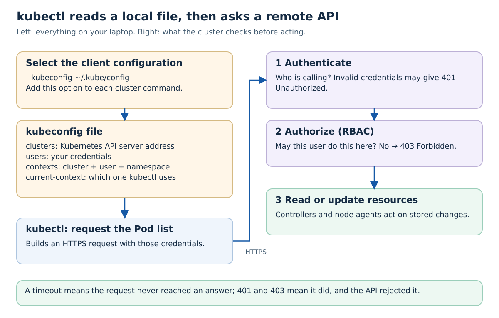

# Tutorial 6: K3s Remote Access and Helm

[Tutorial 5B](../05b-k3s-setup/README.md) installed your group's K3s cluster and copied its administrator configuration to the Ubuntu user's `~/.kube/config`. This tutorial prepares the tools that use that existing cluster. [Tutorial 7](../07-k3s-deploy-applications/README.md) then deploys an application with those tools.

Choose where to work:

- **On the VM through SSH:** complete **section 2** to install Helm, then continue to Tutorial 7. K3s already installed kubectl. The laptop steps are optional.
- **On your laptop:** follow all sections. You will copy the client configuration and carry the API connection through an SSH tunnel. This does not create another cluster or require public access to port 6443.

K3s is the course's Kubernetes distribution. The tools are still called **kubectl** and **Helm**: kubectl reads or changes cluster resources; Helm packages related resource definitions into a **chart** and manages installations called **releases**. Neither tool contains the cluster or grants access by itself. A **kubeconfig** file supplies the API address, credentials, and context.



Every cluster command below selects its file with `--kubeconfig`. There is no environment-variable setup step to repeat in a new terminal. For more command explanations, see [Understanding the commands](../COMMANDS.md).

## 1. Install kubectl on Your Laptop

Use the [official installation instructions](https://kubernetes.io/docs/tasks/tools/) for your operating system. This step is unnecessary on the VM because K3s supplies kubectl there.

```bash
kubectl version --client
```

This reads the installed client's version without contacting a cluster. Follow the [version skew policy](https://kubernetes.io/releases/version-skew-policy/#kubectl): the client should be within one minor version of the API server. You can see the server's version in the node listing once connected; the K3s installer uses its stable release channel.

## 2. Install Helm Where You Will Run Helm Commands

Follow the [official Helm installation guide](https://helm.sh/docs/intro/install/) **on the VM** if you work through SSH, or **on the laptop** if you choose remote access.

```bash
helm version
```

This prints the installed Helm version. It does not check cluster access or install an application. When you later run `helm install ... .`, the dot means the chart files in the current directory on the computer running Helm. That computer needs a checkout of this repository.

**Working on the VM?** Helm can use the private `~/.kube/config` created in Tutorial 5B. Continue to [Tutorial 7: Deploy Applications on K3s](../07-k3s-deploy-applications/README.md); skip the remaining laptop steps.

## 3. Copy the Kubeconfig to Your Laptop

The file contains administrator credentials for the group's cluster. Keep it outside the repository. The following copy **replaces the laptop's `~/.kube/config`**; if you already use another cluster, save your existing file first or use a separate filename consistently in each `--kubeconfig` option.

Replace `203.0.113.10` with the assigned VM IP directly in each command.

### Linux and macOS: Laptop Terminal 1

```bash
mkdir -p ~/.kube
chmod 700 ~/.kube
scp ubuntu@203.0.113.10:.kube/config ~/.kube/config
chmod 600 ~/.kube/config
```

`mkdir -p` creates the directory. `chmod 700` restricts the directory to your account; `chmod 600` restricts reading and writing the file. **scp** copies a file over SSH: `ubuntu@ADDRESS:.kube/config` is the source on the VM, relative to the Ubuntu user's home. The final path is the destination on your laptop. If your login needs a specific key, add `-i /path/to/key` after `scp`.

### Windows PowerShell: Laptop Terminal 1

```powershell
New-Item -Path "$HOME/.kube" -ItemType Directory -Force
scp ubuntu@203.0.113.10:.kube/config "$HOME/.kube/config"
```

`New-Item` creates the directory and scp copies the file. `$HOME` is PowerShell's existing home-directory value; you do not set a new variable. Restrict the file to your Windows account using its security settings.

The copied file initially points to `https://127.0.0.1:6443`. On the VM that means the VM; on your laptop it means your laptop. The next steps set up a local tunnel endpoint.

## 4. Set the Laptop Copy's API Address

**Linux/macOS, Terminal 1:**

```bash
kubectl --kubeconfig ~/.kube/config config set-cluster default --server=https://127.0.0.1:16443
```

**Windows PowerShell, Terminal 1:**

```powershell
kubectl --kubeconfig "$HOME/.kube/config" config set-cluster default --server=https://127.0.0.1:16443
```

`--kubeconfig` selects the laptop file. `config set-cluster default` edits the cluster entry named `default`, which is the name in a fresh K3s configuration. `--server` changes its API address while retaining certificate settings. This edits only the laptop copy; do not change the VM's copy to port 16443.

If you have renamed that cluster entry, read its name with `kubectl --kubeconfig ~/.kube/config config get-clusters` and use that name instead of `default` (use the PowerShell path spelling on Windows).

Port **16443** will be a listener on your laptop. The real API still listens on **6443 on the VM**. TLS certificate verification stays enabled.

## 5. Open the SSH Tunnel in Laptop Terminal 2

Run this in a **second laptop terminal**, on Linux, macOS, or Windows PowerShell:

```bash
ssh -N -o ExitOnForwardFailure=yes -L 127.0.0.1:16443:127.0.0.1:6443 ubuntu@203.0.113.10
```

- `ssh ubuntu@...` connects to your group's VM using the same login as Tutorial 5B.
- `-N` forwards connections without opening a remote shell.
- `-L 127.0.0.1:16443:127.0.0.1:6443` connects the laptop's local port 16443 through SSH to the VM's local port 6443. Binding to the laptop's loopback address keeps other computers from using that listener.
- `-o ExitOnForwardFailure=yes` stops SSH if it cannot create the listener, for example because that laptop port is occupied.

No output can be normal. **Leave Terminal 2 open** and use Terminal 1 for kubectl and Helm. Ctrl+C closes the tunnel; it does not stop the cluster or application. The request path is laptop client → local port 16443 → SSH → VM API port 6443. The API still checks TLS and credentials. See the [SSH manual](https://man.openbsd.org/ssh) for forwarding options.

## 6. Use the Cluster from Laptop Terminal 1

**Linux/macOS:**

```bash
kubectl --kubeconfig ~/.kube/config config current-context
kubectl --kubeconfig ~/.kube/config get nodes
kubectl --kubeconfig ~/.kube/config get pods -n default
helm --kubeconfig ~/.kube/config list --all-namespaces
```

**Windows PowerShell:**

```powershell
kubectl --kubeconfig "$HOME/.kube/config" config current-context
kubectl --kubeconfig "$HOME/.kube/config" get nodes
kubectl --kubeconfig "$HOME/.kube/config" get pods -n default
helm --kubeconfig "$HOME/.kube/config" list --all-namespaces
```

`current-context` reads the selected local context. `get nodes` contacts the API and shows node readiness and server versions. `get pods -n default` reads one namespace; an empty list can be a successful result. `helm list --all-namespaces` reads Helm releases across the cluster; it does not deploy anything.

The configuration edit persists in the file. A new terminal needs no export command, but the tunnel must remain running. If the original K3s credentials are renewed later, refresh the VM copy and the laptop copy, then repeat the laptop endpoint change.

## Interpret a Failed Check

| Result | What to check |
| --- | --- |
| Wrong context or unexpected cluster | The file named by `--kubeconfig` and its selected context. |
| Connection refused at `127.0.0.1:16443` | The tunnel must be running in laptop Terminal 2. |
| SSH connection or authentication error | The assigned VM IP and SSH login details. |
| SSH connects but the forwarded API refuses connections | K3s's service on the VM; use Tutorial 5B's troubleshooting. |
| TLS verification error | The copied configuration, its API address, and whether the credentials are current. |
| `Unauthorized` or `Forbidden` | The selected credentials and their permissions. |
| No Pods in `default` | Inspect the namespace containing your application, such as `tls-demo`. |

## Continue to Application Deployment

[Tutorial 7](../07-k3s-deploy-applications/README.md) uses Helm to deploy an application to this K3s cluster. Remove Tutorial 5B's sample route before reusing the same hostname and `/` path, after completing the environment demonstration or preparing an equivalent replacement.
