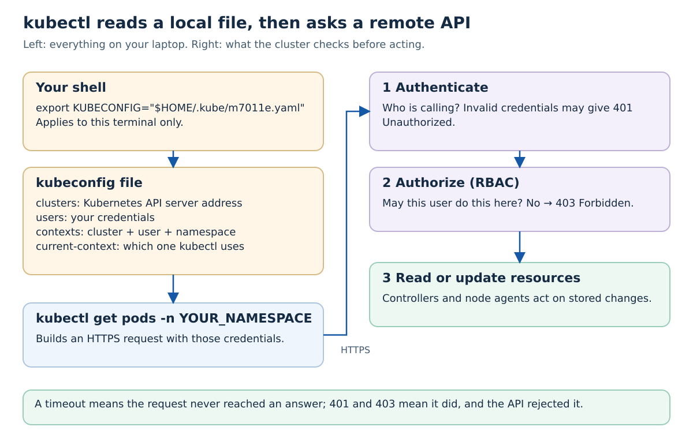

# Tutorial 6: Kubernetes Client Tools and Optional Laptop Access

Complete [Tutorial 5B: K3s on Your VM and HTTPS](../05b-k3s-setup/README.md) first. Your cluster now runs on the group's VM, and its administrator kubeconfig has been copied to the Ubuntu user's `~/.kube/config` with owner-only permissions.

You can keep using kubectl inside SSH on the VM. This tutorial offers another workflow: run kubectl and Helm on your laptop through an **SSH tunnel**. It does not require exposing the Kubernetes API publicly. Both workflows manage the same cluster; neither creates another cluster.

## Why Use an API Client Instead of Logging into Every Server?

Kubernetes exposes an API for declaring and observing resources. Controllers and node agents carry out the work. `kubectl` is a client of that API, not the cluster itself. A kubectl operation does not normally open an SSH session on each node. Here SSH provides VM administration and, optionally, a tunnel carrying the API connection.

Helm is another client-side tool: it packages and renders related resource definitions. Installing either client does not grant permission to use a cluster. The kubeconfig selects the API endpoint, identity, and context.

## What These Commands Configure

| Command | Meaning and scope |
| --- | --- |
| `kubectl version --client` | Reads the installed client version without contacting the cluster. |
| `helm version` | Checks the local Helm client. |
| `scp ...` | Copies the private kubeconfig from the VM through SSH. |
| `export KUBECONFIG=...` | Selects the course file for this shell and its child processes. |
| `kubectl config set-cluster ...` | Changes the API endpoint in the selected local file. |
| `ssh -N -L ...` | Keeps a local port connected through SSH to a remote endpoint. |
| `kubectl config current-context` | Reads which cluster/identity/context is selected locally. |
| `kubectl auth can-i ...` | Asks the API whether the selected identity may perform an operation. |
| `kubectl get pods -n default` | Reads Pods from the selected cluster and namespace. |



Before a deployment, identify the client computer, selected context, namespace, and API path. Changing your working directory does not change the cluster. See [the command guide](../COMMANDS.md) for shell syntax and Kubernetes flags.

## 1. Install kubectl on Your Laptop

Use the [official installation instructions](https://kubernetes.io/docs/tasks/tools/) for your operating system. K3s already provides kubectl on the VM; installing this laptop client is optional.

```bash
kubectl version --client
```

This prints local version information. Choose a client within one minor version of the API server, following the [version skew policy](https://kubernetes.io/releases/version-skew-policy/#kubectl). The pinned cluster in Tutorial 5B uses Kubernetes 1.36; check the actual server version after connecting rather than relying on an old version screenshot.

## 2. Install Helm Where You Will Run Helm Commands

Follow the [Helm installation guide](https://helm.sh/docs/intro/install/) on the laptop, or on the VM if you will run later Helm exercises inside SSH.

```bash
helm version
```

This checks the client, not cluster access. Use the matching computer's repository checkout when later running commands such as `helm install ... .`: `.` means the chart in that computer's current directory.

Docker and Compose remain the local build/run tools from [Tutorial 2](../02-docker/README.md). They are separate from cluster access. The VM's K3s uses its bundled containerd runtime.

## 3. Copy the Kubeconfig to Your Laptop

The source is the private copy created on the VM in Tutorial 5B. It grants administrator access to your group's cluster, so keep the laptop copy outside the repository and readable only by your account. This copy is not a manifest to submit with `kubectl apply`.

### Linux and macOS: Laptop Terminal 1

```bash
VM_IP='203.0.113.10'
mkdir -p "$HOME/.kube"
chmod 700 "$HOME/.kube"
scp "ubuntu@$VM_IP:.kube/config" "$HOME/.kube/m7011e.yaml"
chmod 600 "$HOME/.kube/m7011e.yaml"
export KUBECONFIG="$HOME/.kube/m7011e.yaml"
```

Replace the example IP with the assigned VM address. `mkdir -p` creates the directory, and `chmod` makes the directory and file private to your account. **scp** copies files over SSH: `ubuntu@ADDRESS:.kube/config` names a path relative to the remote Ubuntu user's home; the destination is on your laptop. The separate filename keeps an existing laptop `~/.kube/config` intact. Use `scp -i /path/to/key ...` if your SSH login requires a specific private-key file.

### Windows PowerShell: Laptop Terminal 1

```powershell
$vmIp = '203.0.113.10'
New-Item -Path "$env:USERPROFILE\.kube" -ItemType Directory -Force
scp "ubuntu@${vmIp}:.kube/config" "$env:USERPROFILE\.kube\m7011e.yaml"
$env:KUBECONFIG = "$env:USERPROFILE\.kube\m7011e.yaml"
```

`New-Item` creates the directory, scp copies the remote file, and the environment setting selects the copy for this PowerShell session. Use your own Windows account and restrict the file's access with its security settings.

The file initially names `https://127.0.0.1:6443`. That address meant the VM when used there. On the laptop it means the laptop, so the next two steps configure a local tunnel endpoint.

## 4. Set the Laptop Copy's API Address

### Linux and macOS: Laptop Terminal 1

```bash
COURSE_CLUSTER="$(kubectl config view --minify -o jsonpath='{.clusters[0].name}')"
kubectl config set-cluster "$COURSE_CLUSTER" --server='https://127.0.0.1:16443'
```

### Windows PowerShell: Laptop Terminal 1

```powershell
$courseCluster = kubectl config view --minify -o jsonpath='{.clusters[0].name}'
kubectl config set-cluster "$courseCluster" --server='https://127.0.0.1:16443'
```

`config view --minify` reads the selected context's configuration. The JSONPath expression extracts its cluster entry's name; it does not print the private credentials. `set-cluster` updates that entry's `server` field in the selected laptop file while retaining its CA settings. It does not change the VM's configuration or create another cluster.

Port `16443` is our chosen laptop listener; the API itself still listens on the VM's port `6443`. Certificate validation remains enabled. The tunnel uses the VM's loopback endpoint, which matches the loopback identity in the K3s API certificate.

## 5. Start the SSH Tunnel in a Second Laptop Terminal

Keep Terminal 1 for kubectl. Open another terminal for this long-running SSH connection.

### Linux and macOS: Laptop Terminal 2

```bash
VM_IP='203.0.113.10'
ssh -N -o ExitOnForwardFailure=yes -L 127.0.0.1:16443:127.0.0.1:6443 "ubuntu@$VM_IP"
```

### Windows PowerShell: Laptop Terminal 2

```powershell
$vmIp = '203.0.113.10'
ssh -N -o ExitOnForwardFailure=yes -L 127.0.0.1:16443:127.0.0.1:6443 "ubuntu@$vmIp"
```

Replace the address in this terminal too. `-N` asks SSH to forward connections without starting a remote shell. `-L` binds **laptop** address `127.0.0.1:16443` and forwards through SSH to **VM** address `127.0.0.1:6443`. The first loopback address restricts the listener to your laptop. `ExitOnForwardFailure=yes` makes SSH stop if it cannot establish the forwarding listener, for example because the local port is occupied.

No output can be normal: keep this terminal open. Ctrl+C closes the tunnel; it does not stop K3s or the applications. If you use a different local port, change both the forwarding command and the laptop kubeconfig endpoint. See the [SSH manual](https://man.openbsd.org/ssh) for forwarding options.

The request path is laptop kubectl → local port 16443 → SSH → VM API port 6443. The Kubernetes API still checks its TLS connection and client credentials. This route does not require a public firewall rule for port 6443.

## 6. Check Context and Access in Laptop Terminal 1

```bash
kubectl config get-contexts
kubectl config current-context
kubectl auth can-i list pods -n default
kubectl get pods -n default
kubectl get services -n default
kubectl version
```

The first two commands read local context information. The others contact the VM API through the tunnel. `auth can-i` checks permission; the copied administrator configuration should permit these reads. `-n default` selects one namespace, while later tutorials use namespaces such as `helloworld`, `db`, and `tls-demo`. An empty Pod list can be a successful result. `kubectl version` includes the server version, unlike `--client` alone.

In a new Terminal 1, set `KUBECONFIG` again. In a new Terminal 2, re-establish the tunnel. If the original K3s administrator credentials are renewed later, refresh both the VM copy and the laptop copy; reapply the laptop endpoint change after copying.

If you are working directly on the VM instead, select its `~/.kube/config` as shown in Tutorial 5B and run these checks there. The laptop tunnel and modified laptop endpoint are unnecessary for that workflow.

## Interpret a Failed Check

| Result | What to check |
| --- | --- |
| No current context, or an unexpected cluster name | `KUBECONFIG` in the terminal running kubectl. |
| Connection refused at `127.0.0.1:16443` | The SSH tunnel is not listening, or the client address/port differs from the forwarding command. |
| SSH connection or authentication error | The VM IP, network access to SSH, and the supplied SSH authentication method. |
| Forwarding reports that the remote connection is refused | K3s's service and API listener on the VM. |
| TLS certificate validation error | The selected CA, API endpoint, VM configuration, and whether the copy is current. Do not bypass TLS verification to hide a setup error. |
| `Unauthorized` or `Forbidden` | Authentication or permissions, respectively; inspect the credentials and namespace. |

When reporting a problem, include the command, client computer, context name, namespace, and error. Keep private keys, tokens, and raw kubeconfigs out of issues.

## Check Your Understanding

1. Why does a copied `127.0.0.1:6443` endpoint fail on the laptop without another change?
2. Which two places must agree if you change local port `16443`?
3. Why can `kubectl version --client` succeed when the tunnel is closed?
4. Does closing SSH stop an Nginx Deployment running under K3s?
5. Why must Helm and kubectl select the intended kubeconfig even when the chart files are in the correct directory?

## Next Step

Continue with [Tutorial 7: Hello World](../07-k8s-helloworld/README.md). Use your assigned group domain, confirm the selected context, and remove Tutorial 5B's demo route before deploying a new application on that same hostname and path.
