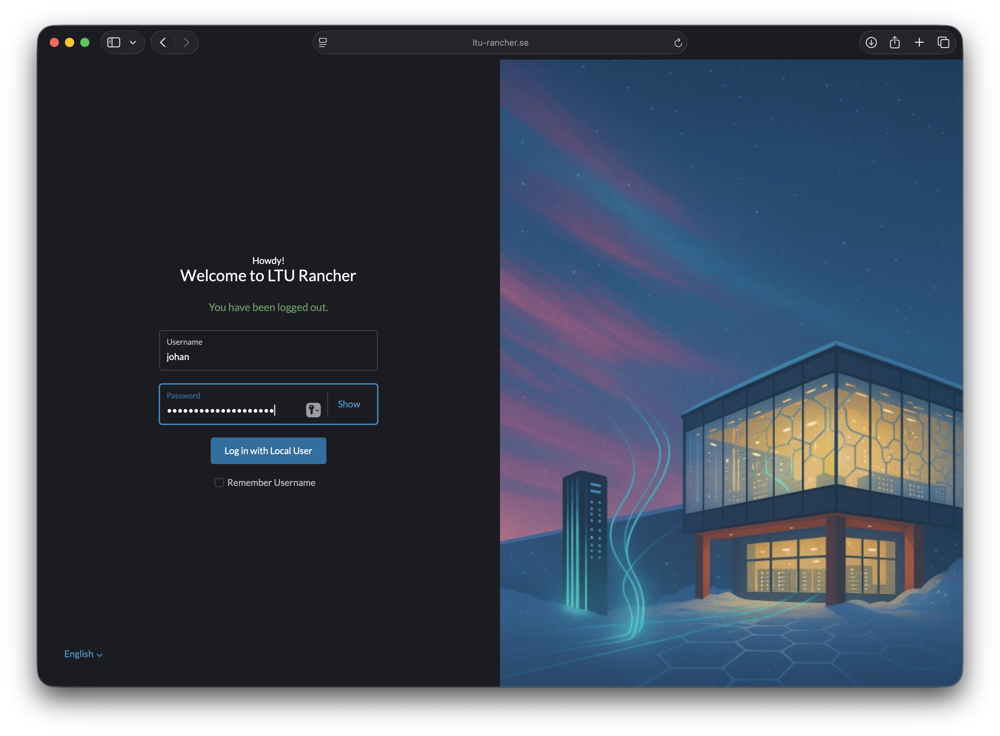
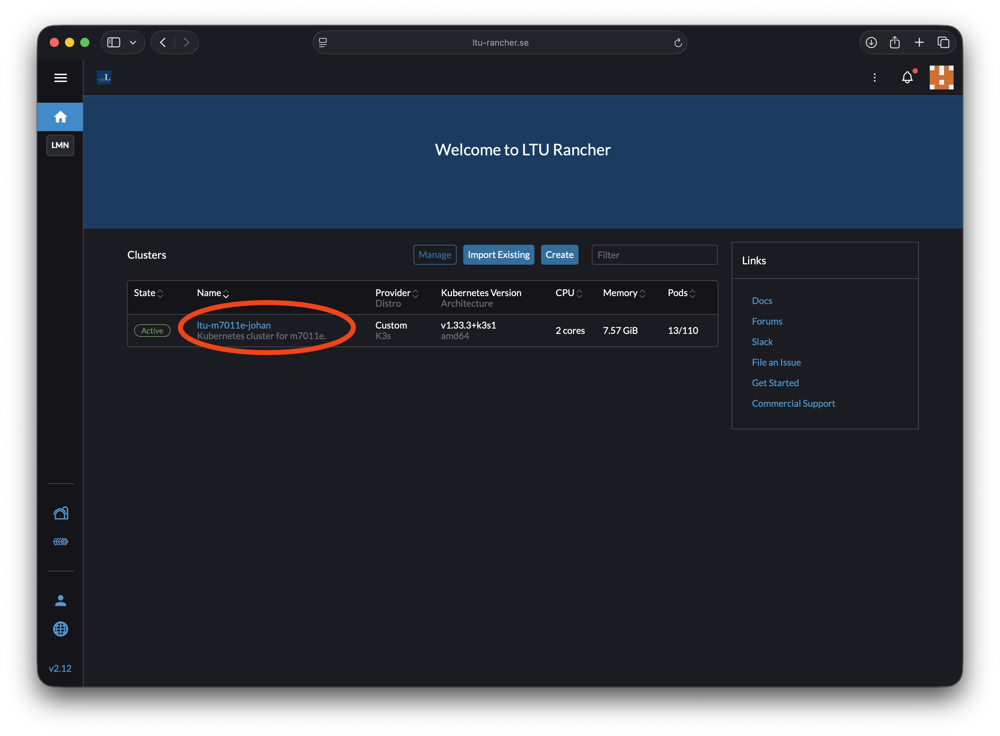
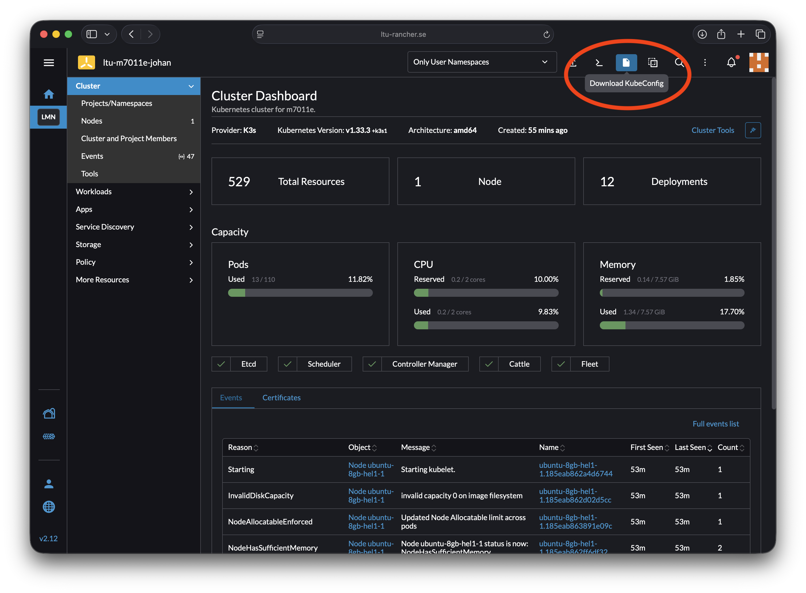

# Tutorial 6 - Getting started using Kubernetes

This guide provides step-by-step instructions to help you begin working with Kubernetes on the LTU-Rancher cluster.

## Why Use an API Client Instead of Logging into Every Server?

With manual server administration, a deployment can depend on a particular host, shell session, and sequence of commands. Kubernetes instead exposes an API for declaring and observing resources. Controllers and node agents carry out the work. `kubectl` is a client of that API; it is not the cluster itself and does not normally deploy by opening SSH sessions to every node.

This explains why client installation, cluster selection, authentication, and namespace permissions are different steps. Helm is another client-side tool: it packages and renders related resource definitions. Having kubectl or Helm installed does not grant permission to change a cluster, and changing your local directory does not select a new cluster.

## What the Setup Commands Actually Configure

`kubectl` and Helm are clients on your computer. Kubernetes runs elsewhere. A **kubeconfig** tells the clients which API server to contact and which credentials and context to use. Installing the clients and configuring access are separate steps.

| Command below | Meaning and scope |
| --- | --- |
| `kubectl version --client` | Prints the local client version without checking cluster access. |
| `helm version`, `docker --version` | Check that those local programs are installed. They do not prove that a cluster or application is reachable. |
| `mkdir -p .kube` | Creates the local configuration directory if needed. `-p` also permits an already-existing directory. |
| `chmod 700 .kube` | Restricts directory access to its owner. |
| `cp ... ~/.kube/m7011e.yaml` | Copies the downloaded configuration to your own machine. Replace the source filename; this does not create cluster resources. |
| `chmod 600 ...` | Allows only the owner to read and write the configuration file. These permissions do not encrypt the credentials in it. |
| `export KUBECONFIG=...` | Selects that file for programs started from the current shell. Another terminal needs its own setting. |
| `kubectl config current-context` | Reads the selected context from local configuration. A context groups a cluster, identity, and optionally a namespace. |
| `kubectl get nodes` | Makes an authenticated request to the selected API server. A Forbidden response indicates a permissions decision; a timeout indicates a different problem. |


**Check your understanding:** Before any later `apply`, `install`, or `delete`, identify the selected cluster and namespace. Explain why changing your terminal's directory does not change your Kubernetes context. See [the command guide](../COMMANDS.md) for shell and namespace syntax.

## 1. Install kubectl
Install the `kubectl` command-line tool to interact with and manage Kubernetes clusters.

**Installation:** Follow the official guide at [https://kubernetes.io/docs/tasks/tools](https://kubernetes.io/docs/tasks/tools/)

## 2. Install Helm
Install `helm`, the package manager for Kubernetes that simplifies application deployment and management.

**Installation:** Follow the official guide at [https://helm.sh/docs/intro/install](https://helm.sh/docs/intro/install/)

## 3. Install Docker or Podman
Install a container runtime to package and run applications as containers. Choose either Docker or Podman. Podman is a modern, daemonless alternative to Docker that offers enhanced security and doesn't require root privileges.

- **Docker Desktop:** [https://www.docker.com/products/docker-desktop](https://www.docker.com/products/docker-desktop)
- **Podman:** [https://podman.io/getting-started/installation](https://podman.io/getting-started/installation)

## 4. Verification
Once everything is installed, verify your setup by running the commands below. Note that the example version strings are illustrative. Choose a kubectl version within one minor version of the cluster API server; see the [Kubernetes version skew policy](https://kubernetes.io/releases/version-skew-policy/). Match the server version shown in Rancher when possible.

### kubectl
```bash
kubectl version --client
```
Expected output (versions may vary):
```text
Client Version: version.Info{Major:"1", Minor:"27", GitVersion:"v1.27.4", GitCommit:"fa3d7990104d7c1f16943a67f11b154b71f6a132", GitTreeState:"clean", BuildDate:"2023-07-19T12:20:54Z", GoVersion:"go1.20.6", Compiler:"gc", Platform:"linux/amd64"}
Kustomize Version: v5.0.1
```

### Helm
```bash
helm version
```
Expected output (versions may vary):
```text
version.BuildInfo{Version:"v3.12.2", GitCommit:"1e210a2c8cc5117d1055bfaa5d40f51bbc2e345e", GitTreeState:"clean", GoVersion:"go1.20.5"}
```

### Docker
```bash
docker --version
```
Expected output (versions may vary):
```text
Docker version 20.10.24+dfsg1, build 297e128
```

# Kubernetes Cluster Access

Contact **Casper Lunderberg** to obtain access credentials for the Kubernetes cluster.

**Cluster Details:**
- **Rancher Management Interface:** [https://ltu-rancher.se](https://ltu-rancher.se)
- **Domain Pattern:** Each cluster includes a pre-registered domain (e.g., `ltu-m7011e-1.se`) for ingress configuration and external access

## Download Kubernetes Configuration

### 1. Log in to Rancher
Navigate to the Rancher interface and log in with your provided credentials.



### 2. Select Your Cluster
Click on your assigned cluster name (e.g., `ltu-m7011e-johan`).



### 3. Download KubeConfig
Click on "Download KubeConfig" to download your cluster configuration file.



### 4. Configure kubectl

#### Linux and macOS
```bash
# Navigate to your home directory
cd ~

# Create the .kube directory if it doesn't exist
mkdir -p .kube

# Set proper permissions
chmod 700 .kube

# Copy the downloaded config file (replace with your actual filename)
cp ~/Downloads/ltu-m7011e-johan.yaml ~/.kube/m7011e.yaml

# Set proper permissions for the config file
chmod 600 ~/.kube/m7011e.yaml

# Select the course config for this shell
export KUBECONFIG="$HOME/.kube/m7011e.yaml"
```

#### Windows (PowerShell)
```powershell
# Navigate to your user profile
cd $env:USERPROFILE

# Create the .kube directory if it doesn't exist
New-Item -Path ".kube" -ItemType Directory -Force

# Copy the downloaded config file (adjust path as needed)
Copy-Item -Path "Downloads\ltu-m7011e-johan.yaml" -Destination ".kube\m7011e.yaml"
$env:KUBECONFIG = "$env:USERPROFILE\.kube\m7011e.yaml"
```

The commands above keep any existing default kubeconfig. Set `KUBECONFIG` again in each new terminal used for the course, or configure your shell profile.

### 5. Verify Connection
Test your cluster connection:
```bash
kubectl config current-context
kubectl get nodes
```

Expected output (node names and details will vary):
```text
NAME                STATUS   ROLES                              AGE   VERSION
ubuntu-8gb-hel1-1   Ready    control-plane,etcd,master,worker   77m   v1.33.3+k3s1
```

If you see output similar to the above showing your cluster nodes in "Ready" status, your kubectl is properly configured and connected to the cluster.

If your course account cannot list nodes, check access to your assigned namespace instead with `kubectl get pods -n YOUR_NAMESPACE`. A Forbidden response can indicate namespace-scoped permissions rather than a connection failure.
