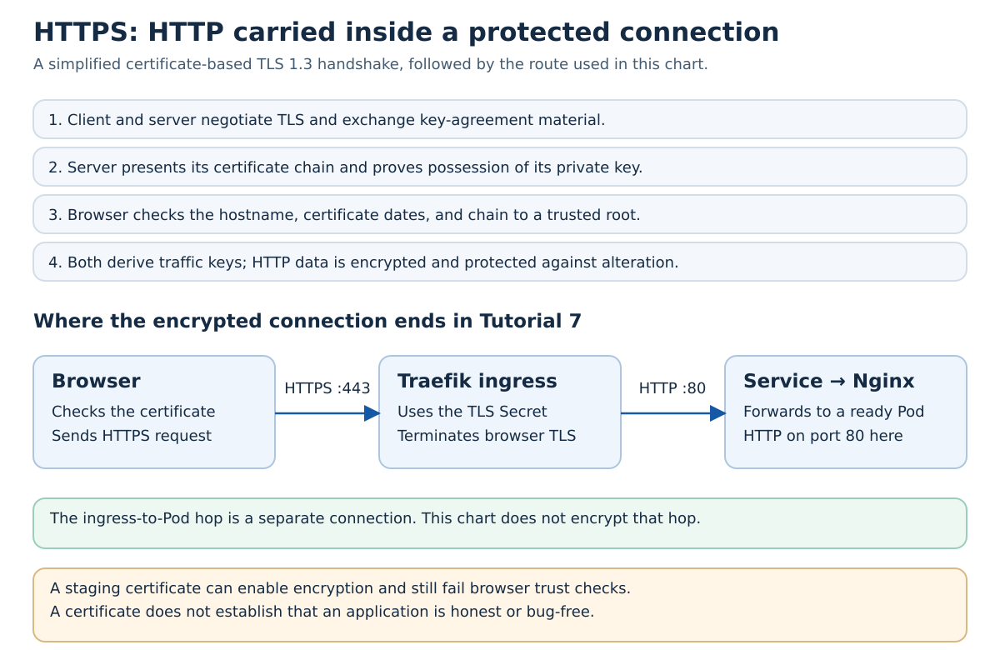
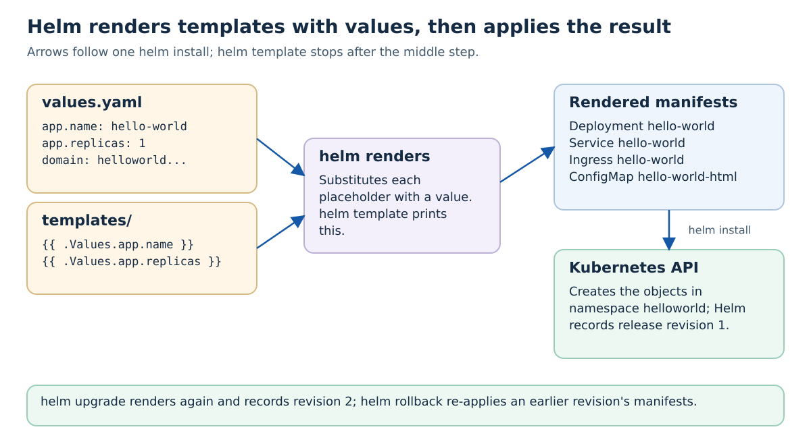
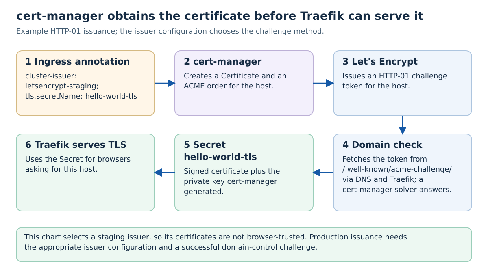
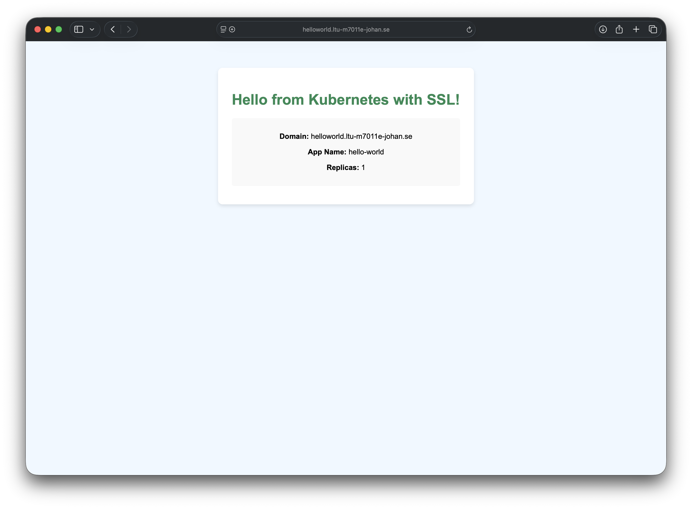
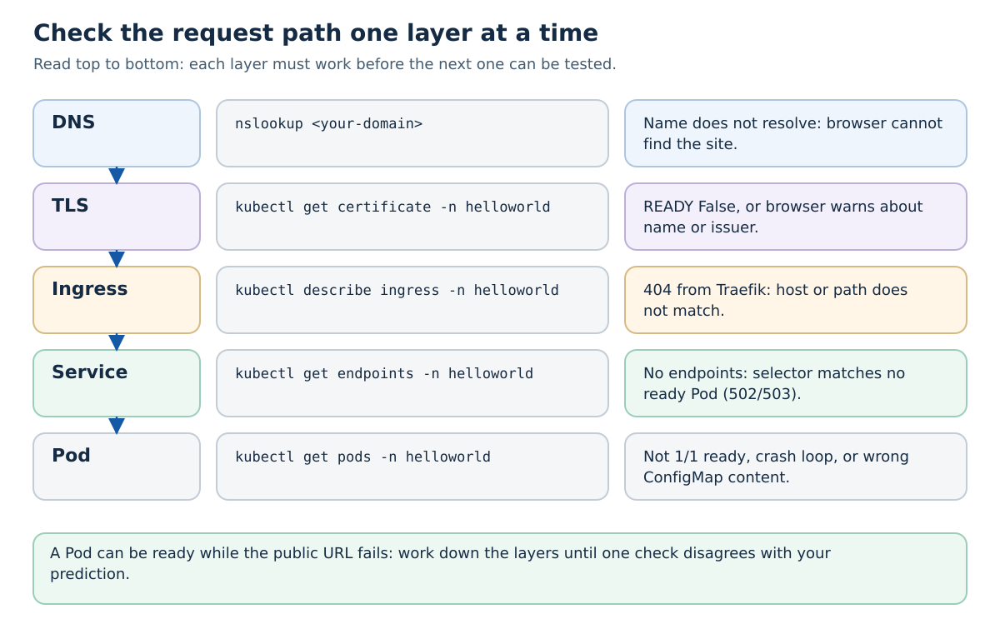

# Tutorial 7 - Deploy a simple web app on Kubernetes 

This tutorial will guide you through deploying a simple application using Helm to verify your Kubernetes setup is working correctly.

Complete [Tutorial 5B: K3s on Your VM and HTTPS](../05b-k3s-setup/README.md) first, including its demo cleanup. It installs the `traefik` ingress class, cert-manager, and the `letsencrypt-staging` and `letsencrypt-prod` ClusterIssuers. Your assigned domain must point to the VM, with ports 80 and 443 reachable.

Run the following commands from `07-k8s-helloworld/` on the VM, or from a laptop configured through [Tutorial 6](../06-k8s-getting-started/README.md). You need the repository files and Helm on whichever computer runs the Helm commands. This chart defaults to staging even if another application previously obtained a production certificate; issuer selection belongs to each application's Ingress.

## Why This Exercise Uses Helm, Ingress, and TLS Together

These tools solve separate problems. Helm lets repeated resource definitions share configuration such as a release's hostname and replica count. An ingress controller routes external HTTP requests to the right internal application. TLS protects a connection and establishes a certificate-based server identity; cert-manager automates obtaining and renewing the certificates used for that identity.

You could serve HTTPS from a single web server without Kubernetes, or apply a small manifest without Helm. Here the tools are combined because you are operating a configurable application on a shared cluster. Trace which problem each one solves rather than treating the installation as one unexplained way to make a URL work.

## Before Deploying: How HTTPS Reaches Your Application

You already used HTTP locally in [Tutorial 1](../01-basic-webapp/README.md#2-follow-one-http-request). Now a browser will contact a public hostname through a shared ingress controller. Follow the request before installing the chart:



**DNS** maps your hostname to an address used to reach the ingress controller. **TLS** protects a connection against reading and undetected modification and, with normal certificate validation, authenticates the server for the requested hostname. **HTTP** carries the actual request and response inside that connection. These solve different problems; a DNS record alone does not configure a route or create a certificate. These protection goals are specified in [TLS 1.3](https://www.rfc-editor.org/rfc/rfc8446.html#section-1).

A certificate contains a public key and names it is valid for, with a signature from its issuer. During a normal certificate-based TLS handshake, the server proves it has the matching private key; that private key is not sent to the browser. The browser checks the hostname, validity period, and certificate chain against trusted roots. The handshake establishes traffic keys used to encrypt and integrity-protect application messages. A valid certificate establishes a protected connection to that hostname; it does not establish that the application's content is trustworthy.

In this chart, **Traefik terminates TLS**: it holds the certificate/key through the referenced Kubernetes Secret, decrypts the browser's request, and forwards a separate HTTP request through the Service to Nginx on port 80. The `tls:` block in an Ingress describes the browser-facing connection. It does not automatically encrypt the next hop to the Pod.

| Configuration | What it contributes | What to inspect |
| --- | --- | --- |
| Domain DNS | An address through which the ingress controller can be reached | Does your configured hostname resolve? |
| Ingress `rules.host` | Selects the application's route from the HTTP hostname | Does the host match your browser URL? |
| Ingress `tls.hosts` and `secretName` | Selects the hostname and certificate Secret for TLS | Does the certificate cover this hostname? |
| `cert-manager.io/cluster-issuer` | Asks cert-manager to obtain a certificate using an existing issuer | Is the Certificate ready, and which issuer signed it? |
| Service selector and port | Selects ready application endpoints and the port to forward to | Does the Service have a matching, ready Pod? |

The default Let's Encrypt **staging** issuer is for testing issuance. Its certificates can support encrypted traffic, but their chain is not trusted by normal browsers. That explains the warning; encryption and certificate trust are separate checks. Issuance also requires proving domain control, which is separate from the browser's later TLS handshake.

**Predict:** What should fail if DNS is wrong? What if the hostname resolves but the certificate covers a different name? What if TLS succeeds but the Service has no ready endpoints? Return to these questions while verifying the deployment.

## Understanding Helm
Helm is a package manager for Kubernetes that simplifies application deployment and management. Think of it like `apt` for Ubuntu or `brew` for macOS, but specifically designed for Kubernetes applications.

### How Helm Works
Helm uses a templating system to generate Kubernetes YAML manifests. Here's how the files in this project work together:

**Project Structure:**
```
07-k8s-helloworld/
├── Chart.yaml              # Chart metadata and version info
├── values.yaml             # Configuration values
└── templates/              # Template directory
    ├── deployment.yaml     # Pod deployment template
    ├── service.yaml        # Service template (networking)
    ├── ingress.yaml        # External access template
    └── configmap.yaml      # HTML content template
```

**Template Processing:**
1. **Values**: The `values.yaml` file contains your configuration (domain, app name, replicas, etc.)
2. **Templates**: Files in `templates/` contain Kubernetes YAML with placeholders like `{{ .Values.app.name }}`
3. **Processing**: Helm substitutes placeholders with actual values from `values.yaml`
4. **Deployment**: Generated YAML manifests are applied to your cluster



**Example Template Usage:**
In `templates/deployment.yaml`, you'll see:
```yaml
name: {{ .Values.app.name }}        # Becomes: hello-world
replicas: {{ .Values.app.replicas }} # Becomes: 1
```

## Project Components
This Helm chart creates several Kubernetes resources:

- **Deployment**: Manages your application pods (nginx containers)
- **Service**: Provides internal networking to reach your pods
- **Ingress**: Enables external access with automatic SSL/TLS certificates
- **ConfigMap**: Contains your HTML content served by nginx

### Automatic SSL Certificate Management
The ingress configuration automatically provisions SSL/TLS certificates using **Let's Encrypt** and **cert-manager**. Here's how it works:

**ACME Protocol**: ACME (Automatic Certificate Management Environment) is a protocol that enables automatic SSL certificate issuance and renewal. It's the standard protocol used by Let's Encrypt to verify domain ownership and issue certificates without manual intervention.

**Certificate Issuer Configuration**:
In the ingress template, you'll see metadata like this:
```yaml
metadata:
  name: {{ .Values.app.name }}
  annotations:
    cert-manager.io/cluster-issuer: letsencrypt-staging
```

The `cert-manager.io/cluster-issuer` annotation tells cert-manager which certificate issuer to use:

- **letsencrypt-staging**: Used for testing and development. Issues certificates from Let's Encrypt's staging environment, which has higher rate limits but produces certificates that browsers will show as "untrusted" (perfect for testing)
- **letsencrypt-prod**: Used for production environments. Issues trusted certificates from Let's Encrypt's production environment, and has stricter [rate limits](https://letsencrypt.org/docs/rate-limits/), including separate limits for registered domains and repeated identifier sets

**The Process**:
1. When you deploy the application, cert-manager detects the `cert-manager.io/cluster-issuer: letsencrypt-staging` annotation
2. Cert-manager uses the ACME protocol to contact Let's Encrypt's servers
3. Let's Encrypt validates that you control the domain (through HTTP-01 challenge)
4. Once verified, Let's Encrypt issues a free SSL certificate
5. The certificate is stored as a Kubernetes secret and automatically applied to your ingress



**Benefits**:
- Free SSL certificates from a trusted Certificate Authority
- Automatic renewal before certificate expiration
- No manual certificate management required
- Industry-standard security for your web application

HTTPS becomes available after DNS, ingress routing, and certificate issuance succeed. The default staging certificate is untrusted by browsers. Switch the annotation to an existing `letsencrypt-prod` issuer when you are ready for a trusted certificate.

## Configure Your Application
### 1. Edit the Values File
Modify `values.yaml` to match your assigned domain:

```yaml
# values.yaml
app:
  name: hello-world
  replicas: 1

domain: group-07-m7011e-ltu.se  # Replace with your assigned group domain

message: "Hello from Kubernetes with SSL!"
```

Replace the example group number with your assigned domain. Using this base domain requires no invented `helloworld` subdomain; a new subdomain would need its own DNS configuration. The chart does not create the ClusterIssuer: its ACME account contact was configured in Tutorial 5B, not by this chart's unused `email` value.

## Understanding Kubernetes Namespaces
A **namespace** in Kubernetes is like a virtual cluster within your physical cluster. It provides:

- **Isolation**: Resources in different namespaces are separated from each other
- **Organization**: Group related resources together (e.g., development, staging, production)
- **Resource Management**: Apply quotas and policies per namespace
- **Naming**: Avoid conflicts by allowing same resource names in different namespaces

Think of namespaces as folders on your computer - they help organize and separate your applications.

## Read the Deployment and Inspection Commands

| Command below | What you ask for | Evidence to inspect |
| --- | --- | --- |
| `kubectl create namespace helloworld` | Create a named scope for this exercise's resources. | The namespace exists; this alone does not create an app or network isolation. |
| `helm install helloworld -f values.yaml -n helloworld .` | Render this directory's chart with the file's values and create a release in the selected cluster. | The release exists; then inspect Pods, routing, and certificates separately. |
| `kubectl get pods -n helloworld` | Read Pod status. | `READY 1/1` is more informative than `Running` alone. Neither proves public HTTPS works. |
| `kubectl get all -n helloworld` | Read a common subset of workload resources. | Despite its name, it does not list every resource type; inspect Ingresses and Certificates explicitly. |
| `kubectl describe ...` | Read detailed resource state and recent associated events. | Look for image, scheduling, endpoint, or certificate errors relevant to that resource. |
| `helm upgrade ...` | Apply a new rendered release revision. | Check that the intended field changed and the workload became ready. |
| `helm rollback ...` | Restore an earlier release revision's configuration. | Inspect the restored resources; external effects and stored data are separate. |

**Observe in stages:** First render locally, then check the workload, then the Service, then routing, then TLS, then the browser response. Explain why a Pod can be ready while the public hostname still fails. `Ctrl+C` stops a watch or port forward; cleanup commands at the end delete resources instead.

## Deploy the Application
### 1. Create Namespace
Create a dedicated namespace for your hello world application:

```bash
kubectl create namespace helloworld
```

This groups your application resources. Network isolation requires separate NetworkPolicies; namespaces alone do not block traffic.

### 2. Install with Helm
Deploy your application using Helm:

```bash
helm install helloworld -f values.yaml -n helloworld .
```

**Command breakdown:**
- `helm install` - Deploy a new application
- `helloworld` - Name of this deployment (release name)
- `-f values.yaml` - Use your custom values file
- `-n helloworld` - Deploy into the "helloworld" namespace
- `.` - Use the current directory as the chart source

## Verify Deployment
Check that your application is running:

```bash
# Check pods in the namespace
kubectl get pods -n helloworld

# Check all resources
kubectl get all -n helloworld

# Check if your ingress is configured
kubectl get ingress -n helloworld

# View your application's HTML content
kubectl get configmap hello-world-html -n helloworld -o yaml
```

### Expected Output
Your pods should show as `Running`:
```text
NAME                           READY   STATUS    RESTARTS   AGE
hello-world-xxxxxxxxxx-xxxxx   1/1     Running   0          2m
```

Your application should now be accessible at your configured group domain (for example, `https://group-07-m7011e-ltu.se` for the example group).



## How the Application Works
This application demonstrates several key Kubernetes concepts:

1. **nginx Container**: Serves a custom HTML page
2. **ConfigMap**: Stores the HTML content that gets mounted into the nginx container
3. **Service**: Provides stable internal networking (ClusterIP)
4. **Ingress**: Handles external traffic and SSL termination using Traefik and Let's Encrypt
5. **Deployment**: Ensures your specified number of replicas are always running

## Troubleshooting



If something goes wrong, you can debug with these commands:

```bash
# Check Helm releases
helm list -n helloworld

# View detailed pod information
kubectl describe pods -n helloworld

# Check application logs
kubectl logs -l app=hello-world -n helloworld

# Check ingress status
kubectl describe ingress hello-world -n helloworld

# Verify certificate status
kubectl get certificate -n helloworld

# Check if DNS is resolving correctly
nslookup group-07-m7011e-ltu.se  # Replace with your assigned domain
```

### Common Issues
- **Pod not starting**: Check `kubectl describe pod` for resource constraints or image issues
- **Website not accessible**: Verify ingress configuration and DNS resolution
- **SSL certificate issues**: Check certificate issuer status and Let's Encrypt rate limits
- **Template errors**: Run `helm template . -f values.yaml` to test template rendering

## Advanced Usage
### Update Your Application
After making changes to values or templates:
```bash
helm upgrade helloworld -f values.yaml -n helloworld .
```

### View Generated YAML
To see what Kubernetes resources Helm will create:
```bash
helm template helloworld -f values.yaml .
```

This renders templates with your values and prints YAML; it does not contact the cluster to install anything. Locate your domain in both `rules.host` and `tls.hosts`, then locate the Service name and its port. Explain how a browser request reaches that Service before applying a change. After deployment, inspect the browser's certificate details and compare its subject names and issuer with your prediction above.

### Rollback Changes
If an update causes issues:
```bash
helm rollback helloworld -n helloworld
```

## Cleanup (when finished)

After verifying and experimenting with the app, remove the release:

```bash
helm uninstall helloworld -n helloworld
```

If the namespace is dedicated to this exercise and you no longer need any of its resources:

```bash
kubectl delete namespace helloworld
```
